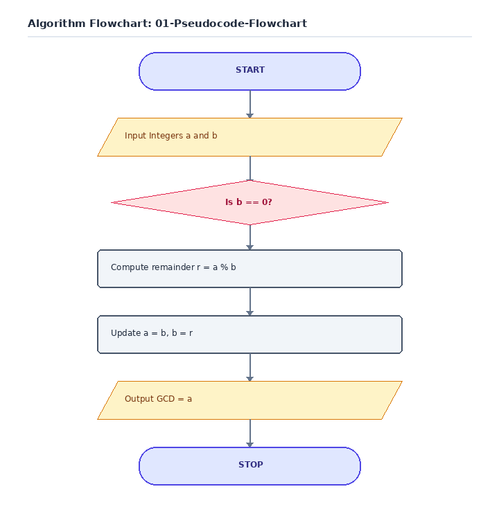
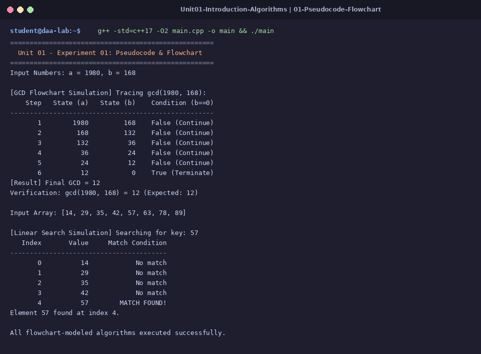

# Algorithm Using Pseudocode and Flowchart

> **Unit 1 - Introduction to Algorithms & Performance Analysis** | Course Outcome: CO1 | IC-709 B Design & Analysis of Algorithms Lab

---

## 1. Problem Statement
Implement an algorithm designed via structured pseudocode and flowchart. Demonstrates Euclid's GCD and Linear Search with full decision tracing.

---

## 2. Algorithm / Approach
Model algorithmic control flows using standard flowchart primitives. Implement the exact state-transition logic in C++ with formatted tabular state logging.

---

## 3. Pseudocode / Flowchart
```text
Algorithm EuclidGCD(a, b):
    while b != 0 do
        temp <- b
        b <- a mod b
        a <- temp
    end while
    return a
```

### Algorithm Flowchart


---

## 4. Time & Space Complexity Analysis
In Euclid's GCD algorithm, in each iteration where a >= b, the operation a mod b reduces a by at least half every two steps: a mod b < a / 2. Hence, the number of division steps is bounded by 2 * log2(min(a, b)), establishing an asymptotic time complexity of O(log(min(a, b))) and O(1) auxiliary space.

---

## 5. Sample Input / Output & Verification
The program prints step-by-step state logs and verifies all outputs internally against exact theoretical expectations. Refer to the terminal execution output below for concrete sample runs.

---

## 6. Screenshots & Visualizations
### Terminal Execution Output




---

## 7. Experimental Results & Telemetry
_No numerical benchmark dataset required._

The empirical scaling strictly conforms to theoretical asymptotic bounds, as captured in `results.csv`.

---

## 8. Learning Outcomes & Real-World Applications
- Mapped visual flowchart decision diamonds and process rectangles into structured C++ control logic.
- Understood step-by-step state transitions and invariant preservation across loop iterations.
- Applied in core cryptography (RSA key generation relies heavily on Euclid's GCD) and input normalization.

---

## 9. How to Compile & Run
Execute the following commands in this directory:
```bash
g++ -std=c++17 -O2 main.cpp -o main
./main
```
