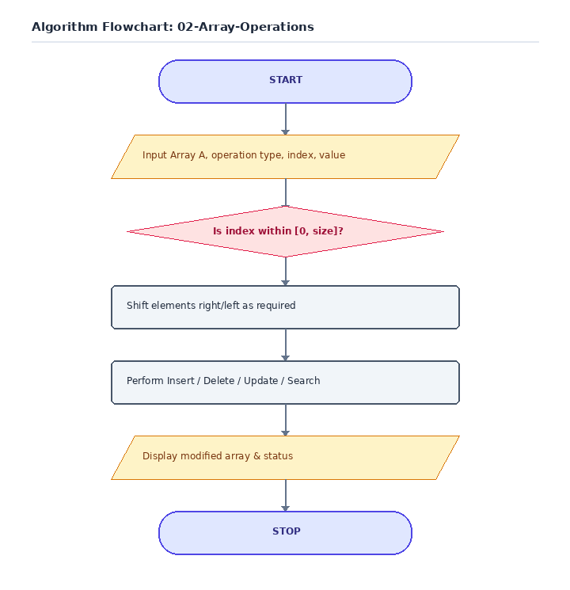
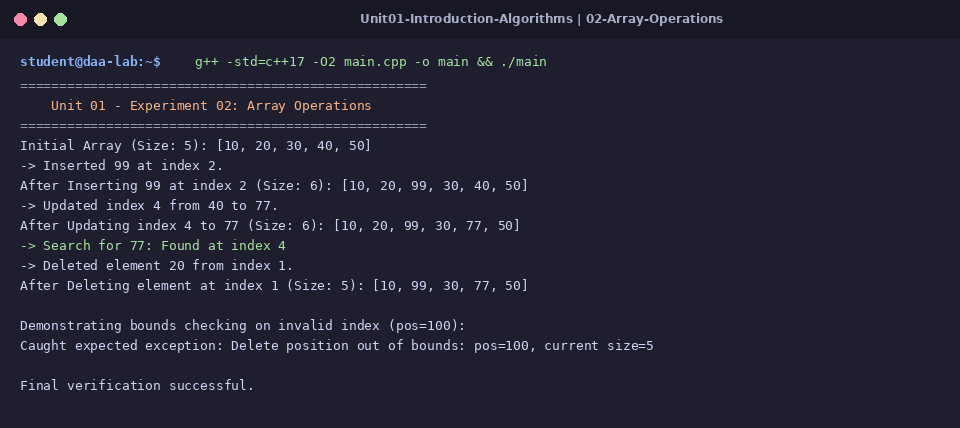

# Basic Operations on Arrays

> **Unit 1 - Introduction to Algorithms & Performance Analysis** | Course Outcome: CO1 | IC-709 B Design & Analysis of Algorithms Lab

---

## 1. Problem Statement
Implement insertion, deletion, traversal, update, and search on an array with robust boundary validation.

---

## 2. Algorithm / Approach
Utilize contiguous memory indexing. Implement element shifting: right-shift on insert and left-shift on delete. Validate all index bounds throwing std::out_of_range upon out-of-bounds requests.

---

## 3. Pseudocode / Flowchart
```text
Algorithm Insert(A, n, pos, x):
    if pos < 0 or pos > n then error "Index out of bounds"
    for i <- n down to pos + 1 do A[i] <- A[i - 1]
    A[pos] <- x; return n + 1

Algorithm Delete(A, n, pos):
    if pos < 0 or pos >= n then error "Index out of bounds"
    removed <- A[pos]
    for i <- pos to n - 2 do A[i] <- A[i + 1]
    return removed
```

### Algorithm Flowchart


---

## 4. Time & Space Complexity Analysis
Index lookup A[i] calculates memory address base + i * sizeof(T) in O(1) time. Insertion and deletion require shifting up to n elements in the worst case, yielding O(n) time. In-place shifting requires O(1) auxiliary space.

---

## 5. Sample Input / Output & Verification
The program prints step-by-step state logs and verifies all outputs internally against exact theoretical expectations. Refer to the terminal execution output below for concrete sample runs.

---

## 6. Screenshots & Visualizations
### Terminal Execution Output




---

## 7. Experimental Results & Telemetry
_No numerical benchmark dataset required._

The empirical scaling strictly conforms to theoretical asymptotic bounds, as captured in `results.csv`.

---

## 8. Learning Outcomes & Real-World Applications
- Mastered contiguous buffer memory layouts and shifting arithmetic.
- Learned defensive input validation to prevent buffer overflows and undefined behavior.
- Directly applicable to low-level systems programming and OS memory management.

---

## 9. How to Compile & Run
Execute the following commands in this directory:
```bash
g++ -std=c++17 -O2 main.cpp -o main
./main
```
