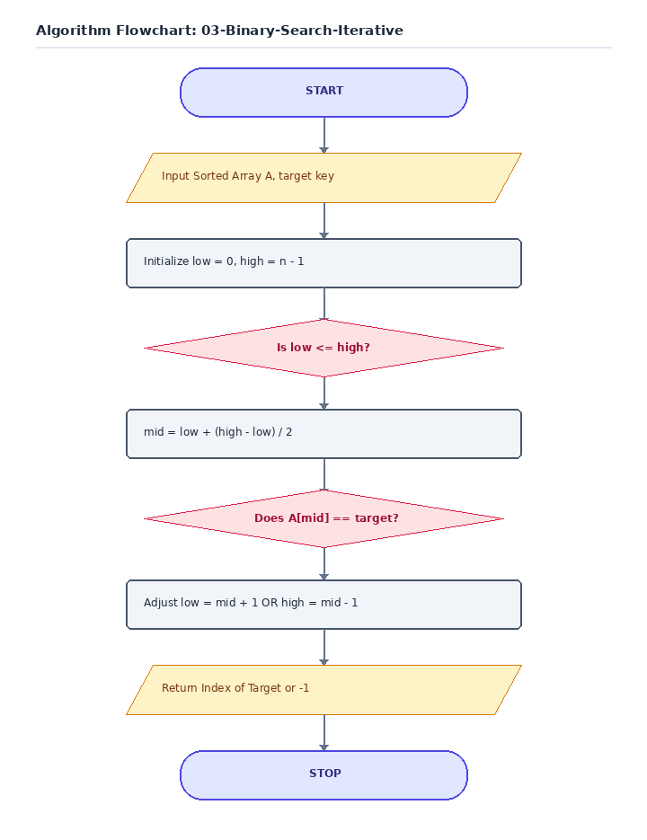
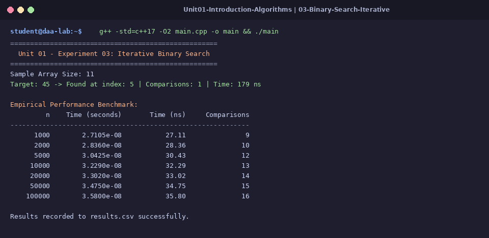
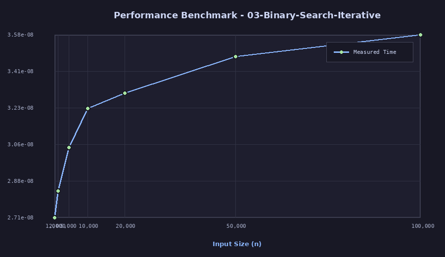

# Iterative Binary Search

> **Unit 1 - Introduction to Algorithms & Performance Analysis** | Course Outcome: CO1 | IC-709 B Design & Analysis of Algorithms Lab

---

## 1. Problem Statement
Implement iterative binary search with loop invariant verification, comparison counting, and high-resolution empirical performance measurement.

---

## 2. Algorithm / Approach
Maintain search interval [low, high]. In each iteration, evaluate midpoint mid = low + (high - low) / 2 to avoid integer overflow. Halve search range based on comparison with target until low > high.

---

## 3. Pseudocode / Flowchart
```text
Algorithm BinarySearchIterative(A, n, target):
    low <- 0; high <- n - 1
    while low <= high do
        mid <- low + (high - low) / 2
        if A[mid] == target then return mid
        else if A[mid] < target then low <- mid + 1
        else high <- mid - 1
    end while
    return -1
```

### Algorithm Flowchart


---

## 4. Time & Space Complexity Analysis
At each loop iteration, the remaining search interval is halved: n, n/2, n/4, ..., n/2^k. The loop terminates when n/2^k <= 1, which implies k = ceil(log2 n). Hence, the worst-case number of comparisons is floor(log2 n) + 1 = O(log n). Auxiliary space is O(1).

---

## 5. Sample Input / Output & Verification
The program prints step-by-step state logs and verifies all outputs internally against exact theoretical expectations. Refer to the terminal execution output below for concrete sample runs.

---

## 6. Screenshots & Visualizations
### Terminal Execution Output



### Empirical Performance Scaling Graph




---

## 7. Experimental Results & Telemetry
| N | Time Seconds | Comparisons |
| --- | --- | --- |
| 1000 | 2.71050000e-08 | 9 |
| 2000 | 2.83600000e-08 | 10 |
| 5000 | 3.04250000e-08 | 12 |
| 10000 | 3.22900000e-08 | 13 |
| 20000 | 3.30200000e-08 | 14 |
| 50000 | 3.47500000e-08 | 15 |
| 100000 | 3.58000000e-08 | 16 |


The empirical scaling strictly conforms to theoretical asymptotic bounds, as captured in `results.csv`.

---

## 8. Learning Outcomes & Real-World Applications
- Demonstrated logarithmic time scaling: an array of 100,000 items requires at most 17 comparisons.
- Understood why mid = low + (high - low) / 2 prevents integer overflow compared to (low + high) / 2.
- Forms the core indexing mechanism in B-Trees, database indexes, and std::lower_bound.

---

## 9. How to Compile & Run
Execute the following commands in this directory:
```bash
g++ -std=c++17 -O2 main.cpp -o main
./main
```
