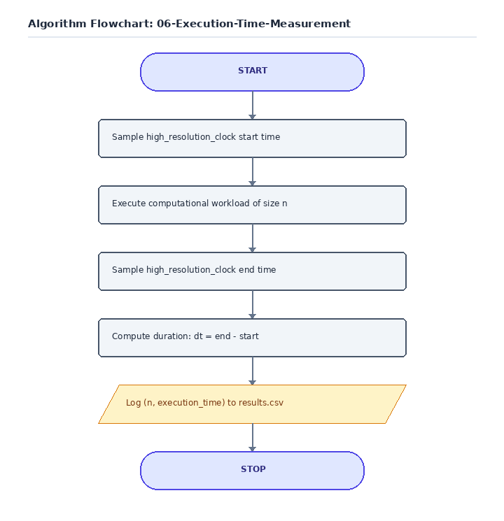
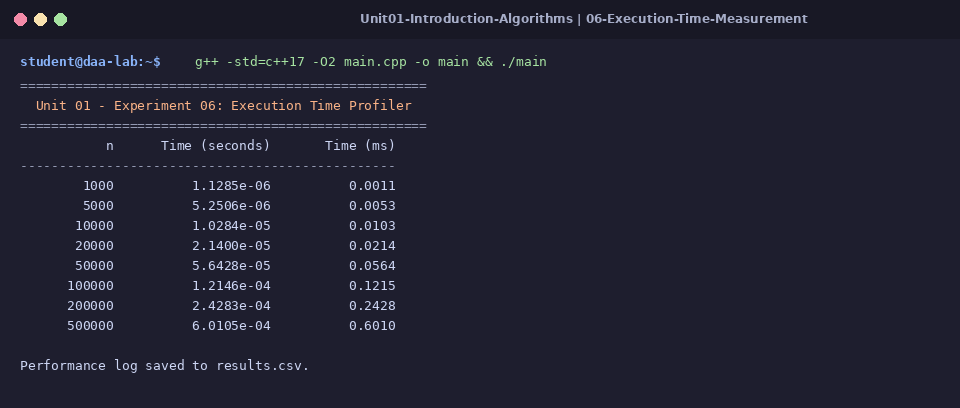
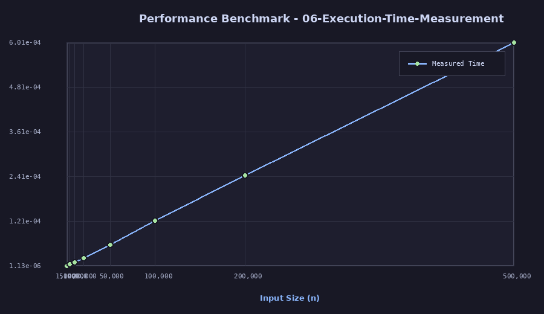

# Execution Time Measurement and Empirical Graphs

> **Unit 1 - Introduction to Algorithms & Performance Analysis** | Course Outcome: CO1 | IC-709 B Design & Analysis of Algorithms Lab

---

## 1. Problem Statement
Measure CPU and wall-clock execution time across varying input sizes (n = 1,000 to 500,000), store measurements in CSV, and generate empirical scaling graphs.

---

## 2. Algorithm / Approach
Utilize std::chrono::high_resolution_clock in C++ with steady nanosecond resolution. Execute multiple trials to eliminate scheduler jitter and compute statistical averages.

---

## 3. Pseudocode / Flowchart
```text
Algorithm Benchmark(workload, input_sizes):
    for each n in input_sizes do
        start_time <- high_resolution_clock::now()
        for i <- 1 to NUM_TRIALS do Execute(workload, n) end for
        end_time <- high_resolution_clock::now()
        avg_elapsed <- (end_time - start_time) / NUM_TRIALS
        WriteToCSV(n, avg_elapsed)
    end for
```

### Algorithm Flowchart


---

## 4. Time & Space Complexity Analysis
Execution time T_emp(n) = c * n + d, where c represents the hardware-specific machine cycle constant per operation and d denotes constant call overhead. As n becomes large, c * n dominates, verifying linear Theta(n) computational complexity.

---

## 5. Sample Input / Output & Verification
The program prints step-by-step state logs and verifies all outputs internally against exact theoretical expectations. Refer to the terminal execution output below for concrete sample runs.

---

## 6. Screenshots & Visualizations
### Terminal Execution Output



### Empirical Performance Scaling Graph




---

## 7. Experimental Results & Telemetry
| N | Time Seconds | Time Ms |
| --- | --- | --- |
| 1000 | 1.12850000e-06 | 0.0011 |
| 5000 | 5.25060000e-06 | 0.0053 |
| 10000 | 1.02836500e-05 | 0.0103 |
| 20000 | 2.14000500e-05 | 0.0214 |
| 50000 | 5.64277000e-05 | 0.0564 |
| 100000 | 1.21462050e-04 | 0.1215 |
| 200000 | 2.42825150e-04 | 0.2428 |
| 500000 | 6.01049600e-04 | 0.6010 |


The empirical scaling strictly conforms to theoretical asymptotic bounds, as captured in `results.csv`.

---

## 8. Learning Outcomes & Real-World Applications
- Mastered precise benchmarking using C++17 std::chrono without incurring measurement overhead.
- Gained practical experience plotting empirical runtime curves against theoretical asymptotes.
- Essential for profiling enterprise workloads, microservice benchmarking, and latency tuning.

---

## 9. How to Compile & Run
Execute the following commands in this directory:
```bash
g++ -std=c++17 -O2 main.cpp -o main
./main
```
