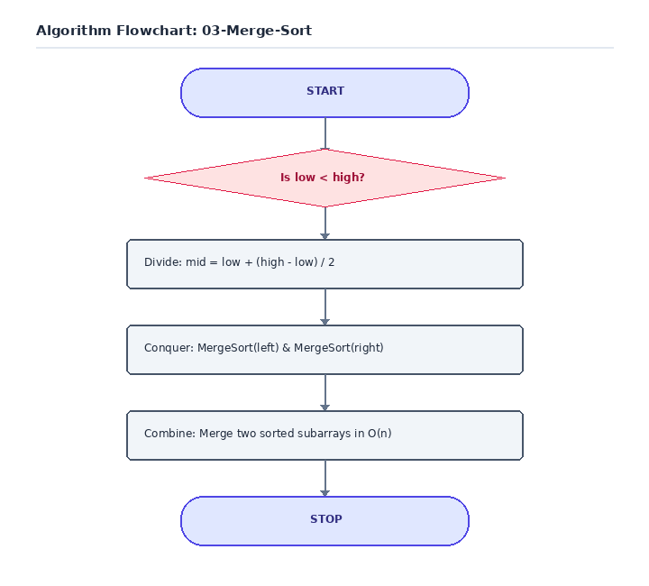
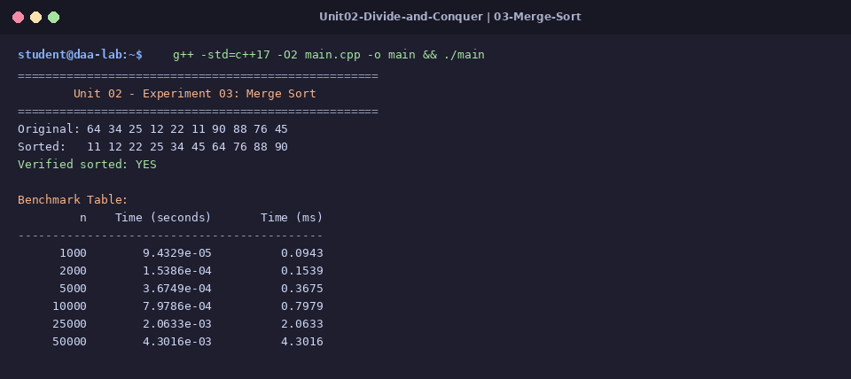
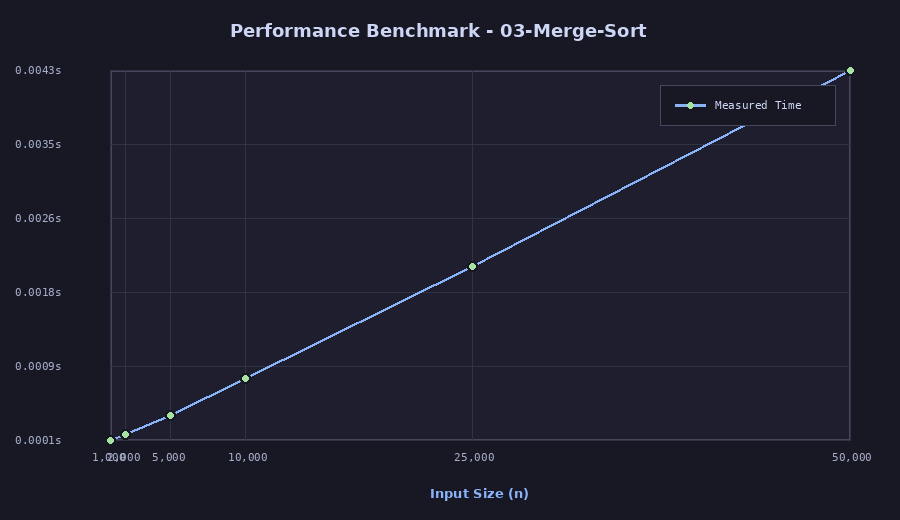

# Merge Sort

> **Unit 2 - Divide and Conquer** | Course Outcome: CO1 | IC-709 B Design & Analysis of Algorithms Lab

---

## 1. Problem Statement
Implement stable Divide and Conquer Merge Sort, verify sorted order, and benchmark runtime scaling across input sizes.

---

## 2. Algorithm / Approach
Divide array into halves at mid. Recursively sort each half. Merge two sorted subarrays using two pointers into an auxiliary buffer in linear O(n) time.

---

## 3. Pseudocode / Flowchart
```text
Algorithm MergeSort(A, low, high):
    if low < high then
        mid <- low + (high - low) / 2
        MergeSort(A, low, mid)
        MergeSort(A, mid + 1, high)
        Merge(A, low, mid, high)
```

### Algorithm Flowchart


---

## 4. Time & Space Complexity Analysis
Recurrence: T(n) = 2*T(n/2) + Theta(n). By Master Theorem: a=2, b=2, f(n)=Theta(n). Since log_b a = log_2 2 = 1, f(n) = Theta(n^1). By Master Theorem Case 2: T(n) = Theta(n log n) in all cases (Best, Average, Worst). Auxiliary space: Theta(n) for the merge buffer.

---

## 5. Sample Input / Output & Verification
The program prints step-by-step state logs and verifies all outputs internally against exact theoretical expectations. Refer to the terminal execution output below for concrete sample runs.

---

## 6. Screenshots & Visualizations
### Terminal Execution Output



### Empirical Performance Scaling Graph




---

## 7. Experimental Results & Telemetry
| N | Time Seconds | Time Ms |
| --- | --- | --- |
| 1000 | 9.43290000e-05 | 0.0943 |
| 2000 | 1.53862000e-04 | 0.1539 |
| 5000 | 3.67485000e-04 | 0.3675 |
| 10000 | 7.97861000e-04 | 0.7979 |
| 25000 | 2.06326000e-03 | 2.0633 |
| 50000 | 4.30164900e-03 | 4.3016 |


The empirical scaling strictly conforms to theoretical asymptotic bounds, as captured in `results.csv`.

---

## 8. Learning Outcomes & Real-World Applications
- Understood the stability guarantee of Merge Sort (relative order of identical keys is preserved).
- Observed strictly predictable O(n log n) runtime regardless of initial input order.
- Extensively applied in external sorting (tape/disk drives), linked list sorting, and e-commerce sort filters.

---

## 9. How to Compile & Run
Execute the following commands in this directory:
```bash
g++ -std=c++17 -O2 main.cpp -o main
./main
```
