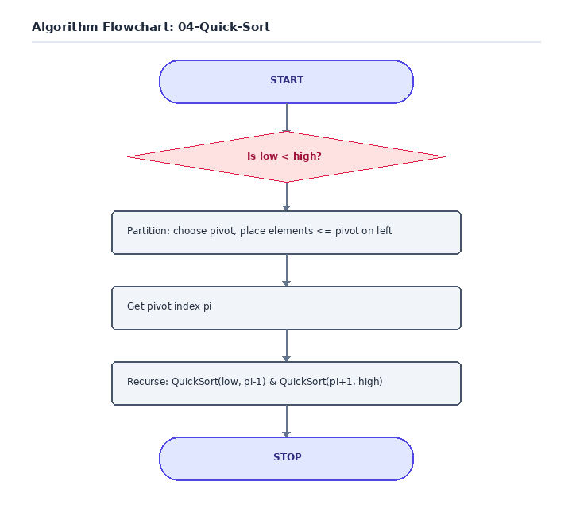
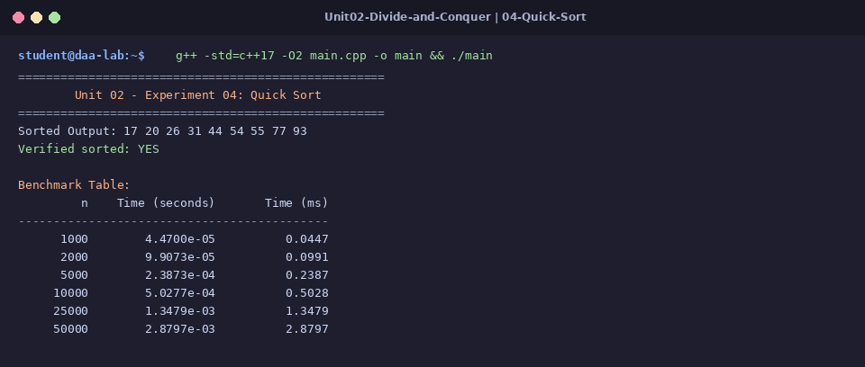
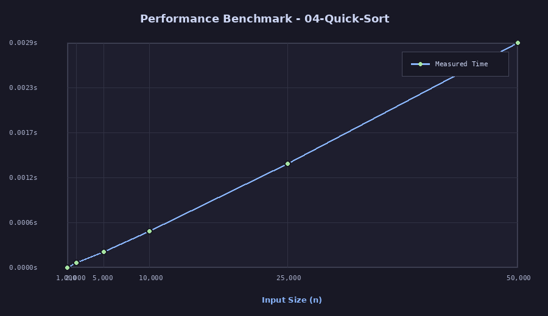

# Quick Sort

> **Unit 2 - Divide and Conquer** | Course Outcome: CO1 | IC-709 B Design & Analysis of Algorithms Lab

---

## 1. Problem Statement
Implement Quick Sort with median-of-three pivot selection to prevent worst-case degradation, and benchmark runtime scaling.

---

## 2. Algorithm / Approach
Select pivot using median-of-three (low, mid, high). Partition array so that all elements <= pivot are placed to the left and larger elements to the right. Recursively sort left and right partitions.

---

## 3. Pseudocode / Flowchart
```text
Algorithm QuickSort(A, low, high):
    if low < high then
        pi <- Partition(A, low, high)
        QuickSort(A, low, pi - 1)
        QuickSort(A, pi + 1, high)
```

### Algorithm Flowchart


---

## 4. Time & Space Complexity Analysis
Best/Average recurrence: T(n) = 2*T(n/2) + Theta(n) => Theta(n log n). Worst-case recurrence (skewed partition): T(n) = T(n-1) + Theta(n) => Theta(n^2). Median-of-three ensures average-case performance on already sorted arrays. Auxiliary space: O(log n) stack.

---

## 5. Sample Input / Output & Verification
The program prints step-by-step state logs and verifies all outputs internally against exact theoretical expectations. Refer to the terminal execution output below for concrete sample runs.

---

## 6. Screenshots & Visualizations
### Terminal Execution Output



### Empirical Performance Scaling Graph




---

## 7. Experimental Results & Telemetry
| N | Time Seconds | Time Ms |
| --- | --- | --- |
| 1000 | 4.47000000e-05 | 0.0447 |
| 2000 | 9.90730000e-05 | 0.0991 |
| 5000 | 2.38727000e-04 | 0.2387 |
| 10000 | 5.02773000e-04 | 0.5028 |
| 25000 | 1.34790000e-03 | 1.3479 |
| 50000 | 2.87973700e-03 | 2.8797 |


The empirical scaling strictly conforms to theoretical asymptotic bounds, as captured in `results.csv`.

---

## 8. Learning Outcomes & Real-World Applications
- Understood why in-place partitioning makes Quick Sort empirically faster than Merge Sort due to cache locality.
- Learned how median-of-three pivot selection protects against adversarial sorted inputs.
- Default sorting algorithm in modern standard libraries (std::sort utilizes introsort / quicksort hybrid).

---

## 9. How to Compile & Run
Execute the following commands in this directory:
```bash
g++ -std=c++17 -O2 main.cpp -o main
./main
```
