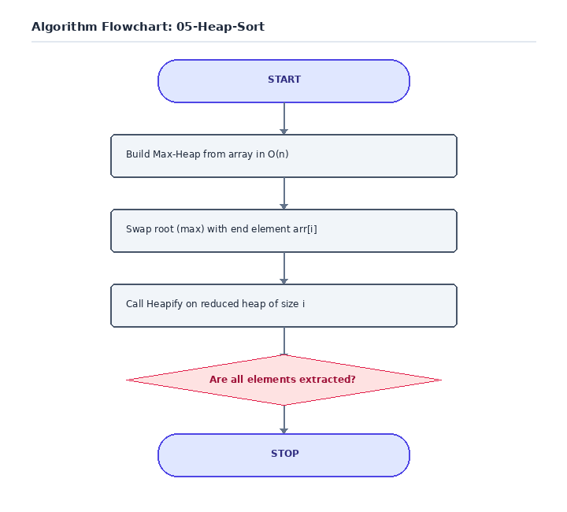
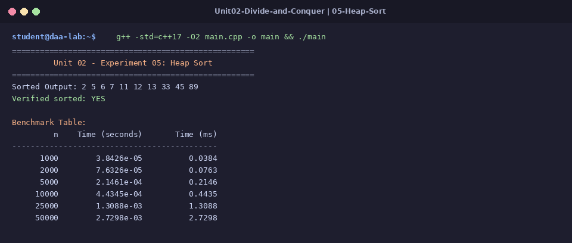
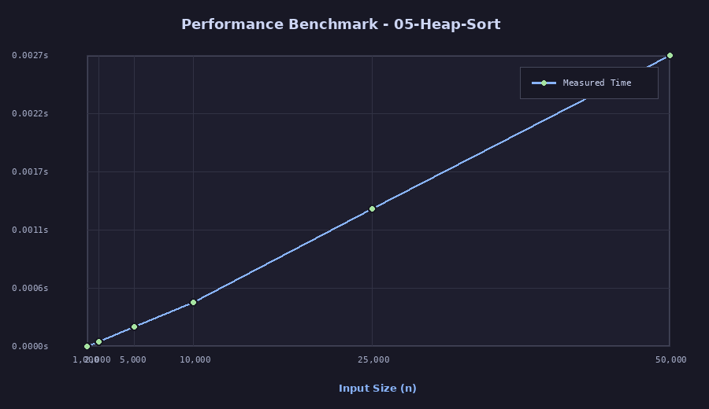

# Heap Sort

> **Unit 2 - Divide and Conquer** | Course Outcome: CO1 | IC-709 B Design & Analysis of Algorithms Lab

---

## 1. Problem Statement
Implement in-place Heap Sort using max-heapify and build-heap procedures, achieving O(n log n) time and O(1) auxiliary space.

---

## 2. Algorithm / Approach
Build a Max-Heap from the array in O(n) time. Repeatedly swap the root element (maximum) with the last element of the heap, decrement heap size, and call heapify on root.

---

## 3. Pseudocode / Flowchart
```text
Algorithm HeapSort(A, n):
    for i <- floor(n/2) - 1 down to 0 do Heapify(A, n, i) end for
    for i <- n - 1 down to 1 do
        swap(A[0], A[i])
        Heapify(A, i, 0)
    end for
```

### Algorithm Flowchart


---

## 4. Time & Space Complexity Analysis
Build-Heap: sum_{h=0}^{floor(log n)} ceil(n / 2^(h+1)) * O(h) = O(n). Extraction loop: n - 1 extractions, each requiring O(log n) sift-down operations = O(n log n). Total time: O(n log n) in all cases. Auxiliary space: O(1) (completely in-place).

---

## 5. Sample Input / Output & Verification
The program prints step-by-step state logs and verifies all outputs internally against exact theoretical expectations. Refer to the terminal execution output below for concrete sample runs.

---

## 6. Screenshots & Visualizations
### Terminal Execution Output



### Empirical Performance Scaling Graph




---

## 7. Experimental Results & Telemetry
| N | Time Seconds | Time Ms |
| --- | --- | --- |
| 1000 | 3.84260000e-05 | 0.0384 |
| 2000 | 7.63260000e-05 | 0.0763 |
| 5000 | 2.14612000e-04 | 0.2146 |
| 10000 | 4.43454000e-04 | 0.4435 |
| 25000 | 1.30880600e-03 | 1.3088 |
| 50000 | 2.72976500e-03 | 2.7298 |


The empirical scaling strictly conforms to theoretical asymptotic bounds, as captured in `results.csv`.

---

## 8. Learning Outcomes & Real-World Applications
- Proved that Build-Heap runs in linear O(n) time rather than O(n log n).
- Appreciated O(1) in-place sorting advantage when memory is strictly constrained.
- Applied in priority queues, kernel process schedulers, and embedded systems.

---

## 9. How to Compile & Run
Execute the following commands in this directory:
```bash
g++ -std=c++17 -O2 main.cpp -o main
./main
```
