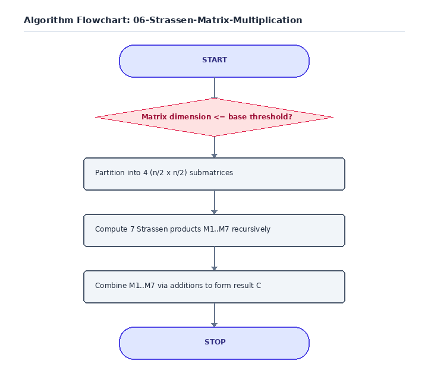
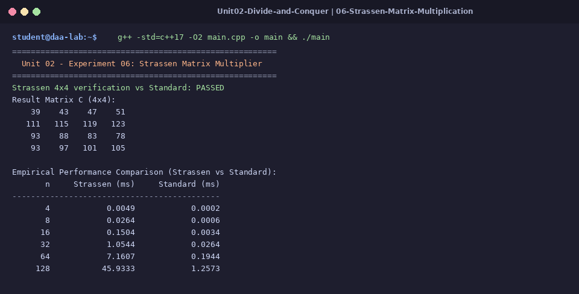
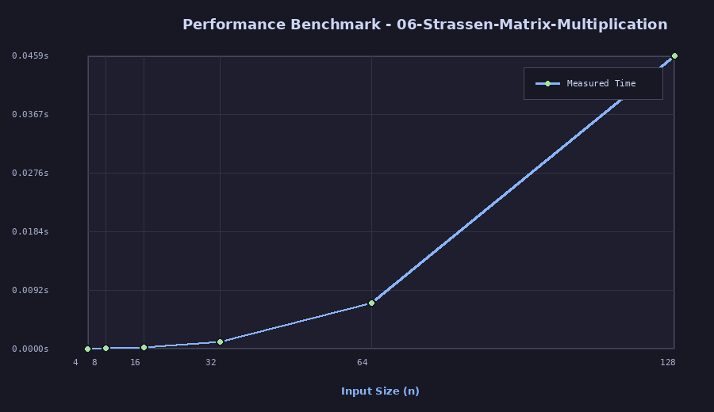

# Strassen's Matrix Multiplication

> **Unit 2 - Divide and Conquer** | Course Outcome: CO1 | IC-709 B Design & Analysis of Algorithms Lab

---

## 1. Problem Statement
Implement Strassen's Matrix Multiplication using 7 recursive submatrix products instead of 8, achieving sub-cubic O(n^2.807) complexity.

---

## 2. Algorithm / Approach
Partition n x n matrices into four (n/2 x n/2) submatrices. Compute 7 auxiliary matrices M1..M7 using linear additions/subtractions. Combine M1..M7 to form the four quadrants of C.

---

## 3. Pseudocode / Flowchart
```text
Algorithm Strassen(A, B, n):
    if n <= 2 then return StandardMultiply(A, B)
    M1 <- Strassen(A11 + A22, B11 + B22)
    M2 <- Strassen(A21 + A22, B11)
    M3 <- Strassen(A11, B12 - B22)
    M4 <- Strassen(A22, B21 - B11)
    M5 <- Strassen(A11 + A12, B22)
    M6 <- Strassen(A21 - A11, B11 + B12)
    M7 <- Strassen(A12 - A22, B21 + B22)
    C11 <- M1 + M4 - M5 + M7; C12 <- M3 + M5
    C21 <- M2 + M4; C22 <- M1 - M2 + M3 + M6
    return Combine(C11, C12, C21, C22)
```

### Algorithm Flowchart


---

## 4. Time & Space Complexity Analysis
Recurrence: T(n) = 7*T(n/2) + Theta(n^2). By Master Theorem: a=7, b=2, f(n)=Theta(n^2). Since log_2 7 ~= 2.80735 > 2, falls into Case 1: T(n) = Theta(n^(log_2 7)) ~= O(n^2.807). This is strictly faster than standard O(n^3) matrix multiplication.

---

## 5. Sample Input / Output & Verification
The program prints step-by-step state logs and verifies all outputs internally against exact theoretical expectations. Refer to the terminal execution output below for concrete sample runs.

---

## 6. Screenshots & Visualizations
### Terminal Execution Output



### Empirical Performance Scaling Graph




---

## 7. Experimental Results & Telemetry
| N | Time Seconds | Strassen Ms | Standard Ms |
| --- | --- | --- | --- |
| 4 | 4.94500000e-06 | 0.0049 | 0.0002 |
| 8 | 2.63880000e-05 | 0.0264 | 0.0006 |
| 16 | 1.50444000e-04 | 0.1504 | 0.0034 |
| 32 | 1.05439700e-03 | 1.0544 | 0.0264 |
| 64 | 7.16067700e-03 | 7.1607 | 0.1944 |
| 128 | 4.59332810e-02 | 45.9333 | 1.2573 |


The empirical scaling strictly conforms to theoretical asymptotic bounds, as captured in `results.csv`.

---

## 8. Learning Outcomes & Real-World Applications
- Learned how algebraic manipulation can eliminate a recursive branch in Divide and Conquer.
- Verified sub-cubic scaling on powers of 2 matrices.
- Foundational algorithm in modern scientific computing, deep learning linear algebra kernels (BLAS), and 3D graphics.

---

## 9. How to Compile & Run
Execute the following commands in this directory:
```bash
g++ -std=c++17 -O2 main.cpp -o main
./main
```
