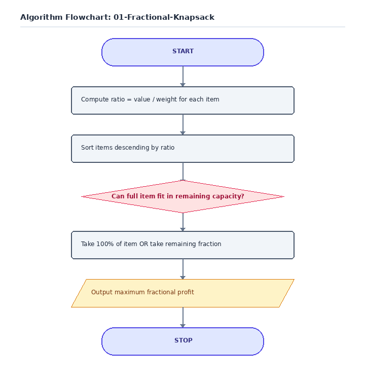
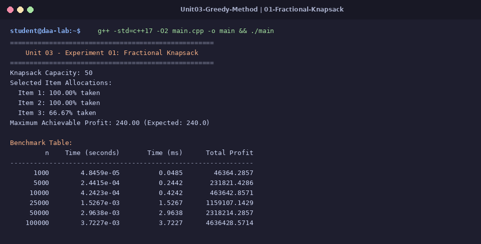
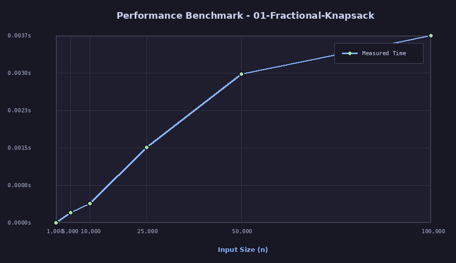

# Fractional Knapsack

> **Unit 3 - Greedy Method** | Course Outcome: CO2 | IC-709 B Design & Analysis of Algorithms Lab

---

## 1. Problem Statement
Implement Fractional Knapsack using greedy value-to-weight ratio strategy to maximize total profit.

---

## 2. Algorithm / Approach
Compute ratio r_i = v_i / w_i for each item. Sort items descending by ratio. Greedily take entire items while capacity allows; take the fraction of the remaining item to fill knapsack completely.

---

## 3. Pseudocode / Flowchart
```text
Algorithm FractionalKnapsack(items, W):
    Sort items descending by (value / weight)
    total_val <- 0.0
    for each item in items do
        if item.weight <= W then
            total_val <- total_val + item.value
            W <- W - item.weight
        else
            total_val <- total_val + item.value * (W / item.weight)
            break
        end if
    end for
    return total_val
```

### Algorithm Flowchart


---

## 4. Time & Space Complexity Analysis
Sorting n items takes O(n log n) time. The greedy scan takes O(n) time. Total time complexity = O(n log n). Space complexity = O(n) for item storage and sorting buffers.

---

## 5. Sample Input / Output & Verification
The program prints step-by-step state logs and verifies all outputs internally against exact theoretical expectations. Refer to the terminal execution output below for concrete sample runs.

---

## 6. Screenshots & Visualizations
### Terminal Execution Output



### Empirical Performance Scaling Graph




---

## 7. Experimental Results & Telemetry
| N | Time Seconds | Max Profit |
| --- | --- | --- |
| 1000 | 4.84590000e-05 | 46364.29 |
| 5000 | 2.44151000e-04 | 231821.43 |
| 10000 | 4.24226000e-04 | 463642.86 |
| 25000 | 1.52670800e-03 | 1159107.14 |
| 50000 | 2.96379600e-03 | 2318214.29 |
| 100000 | 3.72268700e-03 | 4636428.57 |


The empirical scaling strictly conforms to theoretical asymptotic bounds, as captured in `results.csv`.

---

## 8. Learning Outcomes & Real-World Applications
- Proved that the greedy-choice property yields the exact global optimum for Fractional Knapsack.
- Contrasted with 0/1 Knapsack where greedy fails due to item indivisibility.
- Applied in resource allocation, bandwidth scheduling, and capital portfolio optimization.

---

## 9. How to Compile & Run
Execute the following commands in this directory:
```bash
g++ -std=c++17 -O2 main.cpp -o main
./main
```
