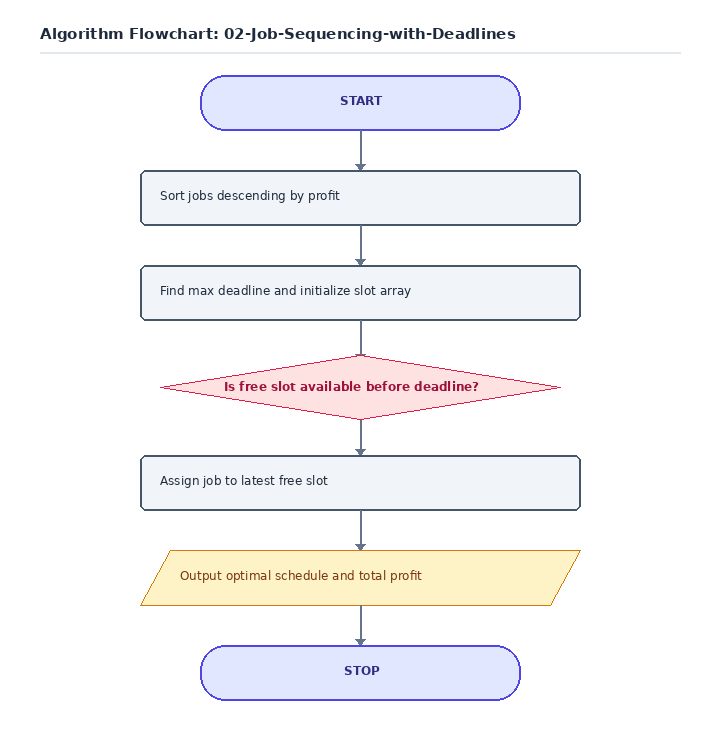
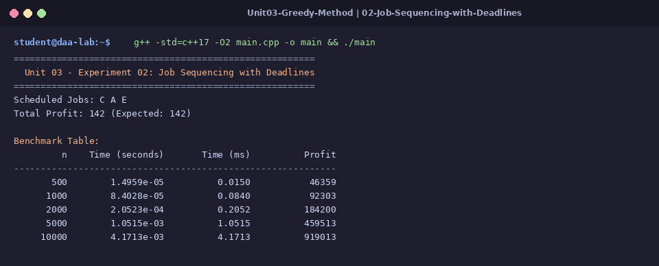
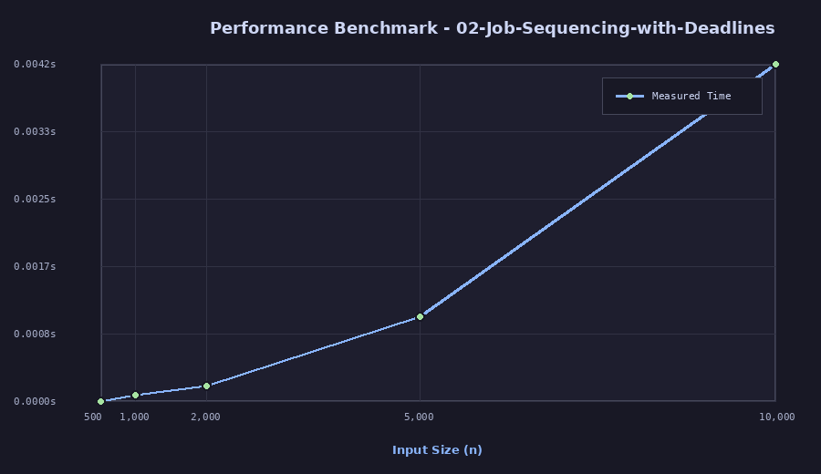

# Job Sequencing with Deadlines

> **Unit 3 - Greedy Method** | Course Outcome: CO2 | IC-709 B Design & Analysis of Algorithms Lab

---

## 1. Problem Statement
Schedule a set of jobs with deadlines and profits to maximize total profit, ensuring each job takes unit time.

---

## 2. Algorithm / Approach
Sort jobs descending by profit. For each job, greedily search for the latest available time slot t <= deadline. Assign job if free slot found; otherwise reject.

---

## 3. Pseudocode / Flowchart
```text
Algorithm JobSequencing(jobs):
    Sort jobs descending by profit
    max_d <- max(deadline of all jobs)
    slot <- array of size max_d + 1 initialized to empty
    for each job in jobs do
        for t <- job.deadline down to 1 do
            if slot[t] is empty then
                slot[t] <- job.id
                total_profit <- total_profit + job.profit
                break
            end if
        end for
    end for
    return total_profit
```

### Algorithm Flowchart


---

## 4. Time & Space Complexity Analysis
Sorting takes O(n log n). For each of n jobs, slot scanning takes at most min(n, max_deadline) steps, yielding O(n * min(n, d)) time. Space complexity: O(d) for the slot allocation table.

---

## 5. Sample Input / Output & Verification
The program prints step-by-step state logs and verifies all outputs internally against exact theoretical expectations. Refer to the terminal execution output below for concrete sample runs.

---

## 6. Screenshots & Visualizations
### Terminal Execution Output



### Empirical Performance Scaling Graph




---

## 7. Experimental Results & Telemetry
| N | Time Seconds | Total Profit |
| --- | --- | --- |
| 500 | 1.49590000e-05 | 46359 |
| 1000 | 8.40280000e-05 | 92303 |
| 2000 | 2.05230000e-04 | 184200 |
| 5000 | 1.05147300e-03 | 459513 |
| 10000 | 4.17134200e-03 | 919013 |


The empirical scaling strictly conforms to theoretical asymptotic bounds, as captured in `results.csv`.

---

## 8. Learning Outcomes & Real-World Applications
- Learned greedy slot allocation prioritizing high-profit jobs as late as permissible.
- Understood how disjoint-set data structures can optimize slot lookup to O(n * alpha(d)).
- Applied in manufacturing batch scheduling, cloud task dispatching, and CPU deadline schedulers.

---

## 9. How to Compile & Run
Execute the following commands in this directory:
```bash
g++ -std=c++17 -O2 main.cpp -o main
./main
```
