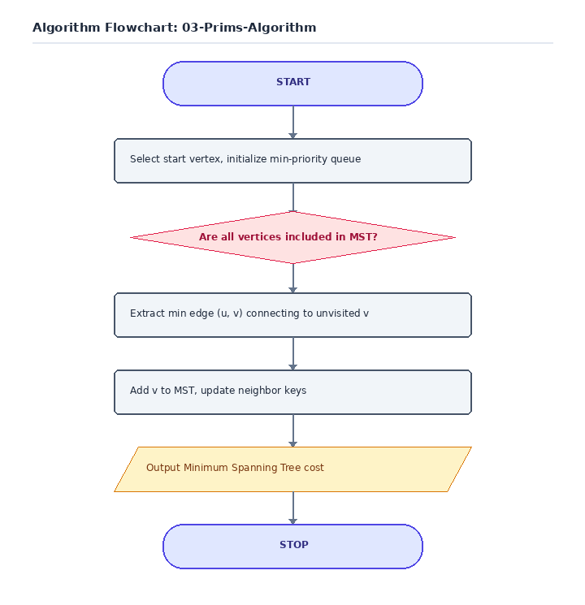
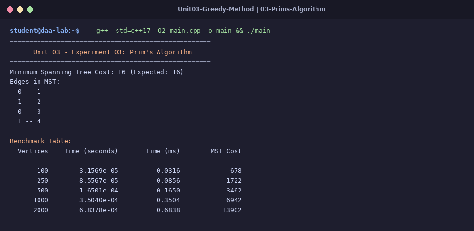
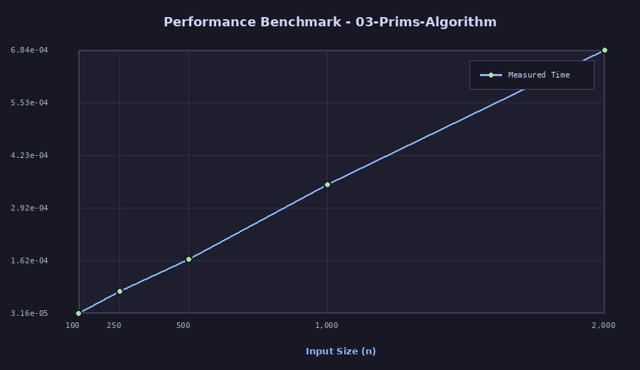

# Minimum Cost Spanning Tree - Prim's Algorithm

> **Unit 3 - Greedy Method** | Course Outcome: CO2 | IC-709 B Design & Analysis of Algorithms Lab

---

## 1. Problem Statement
Construct a Minimum Spanning Tree (MST) from an arbitrary root vertex using Prim's algorithm with priority queue.

---

## 2. Algorithm / Approach
Maintain a priority queue of vertices keyed by their minimum connection cost to the growing tree. In each step, extract vertex u with minimum key, add to MST, and relax all incident edges (u, v).

---

## 3. Pseudocode / Flowchart
```text
Algorithm PrimsMST(V, adj):
    key <- array of size V filled with INF, key[0] <- 0
    inMST <- array of size V filled with false
    pq.push((0, 0))
    while pq not empty do
        (w, u) <- pq.pop()
        if inMST[u] then continue
        inMST[u] <- true; total_cost += w
        for each (v, weight) in adj[u] do
            if not inMST[v] and weight < key[v] then
                key[v] <- weight; pq.push((key[v], v))
            end if
        end for
    end while
    return total_cost
```

### Algorithm Flowchart


---

## 4. Time & Space Complexity Analysis
Using an adjacency list and binary min-heap: each vertex is extracted once (V * O(log V)), and each edge is examined once to update keys (E * O(log V)). Total time complexity = O((V + E) log V) = O(E log V). Space complexity = O(V + E).

---

## 5. Sample Input / Output & Verification
The program prints step-by-step state logs and verifies all outputs internally against exact theoretical expectations. Refer to the terminal execution output below for concrete sample runs.

---

## 6. Screenshots & Visualizations
### Terminal Execution Output



### Empirical Performance Scaling Graph




---

## 7. Experimental Results & Telemetry
| N | Time Seconds | Mst Cost |
| --- | --- | --- |
| 100 | 3.15690000e-05 | 678 |
| 250 | 8.55670000e-05 | 1722 |
| 500 | 1.65005000e-04 | 3462 |
| 1000 | 3.50404000e-04 | 6942 |
| 2000 | 6.83777000e-04 | 13902 |


The empirical scaling strictly conforms to theoretical asymptotic bounds, as captured in `results.csv`.

---

## 8. Learning Outcomes & Real-World Applications
- Understood tree-growing greedy strategy (vertex-centric expansion).
- Proved cut property: the lightest edge crossing any cut must belong to the MST.
- Applied in electrical grid design, circuit layout routing, and LAN spanning tree protocols (STP).

---

## 9. How to Compile & Run
Execute the following commands in this directory:
```bash
g++ -std=c++17 -O2 main.cpp -o main
./main
```
