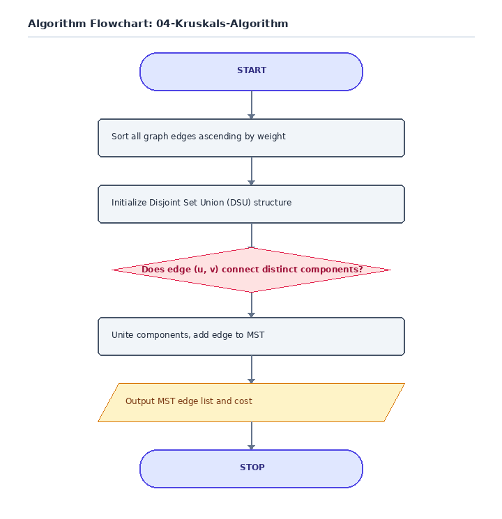
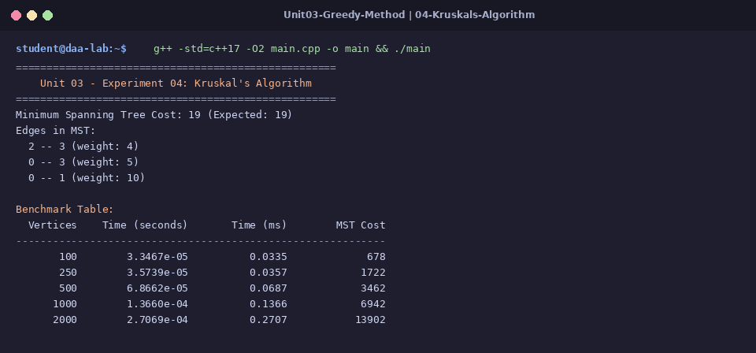
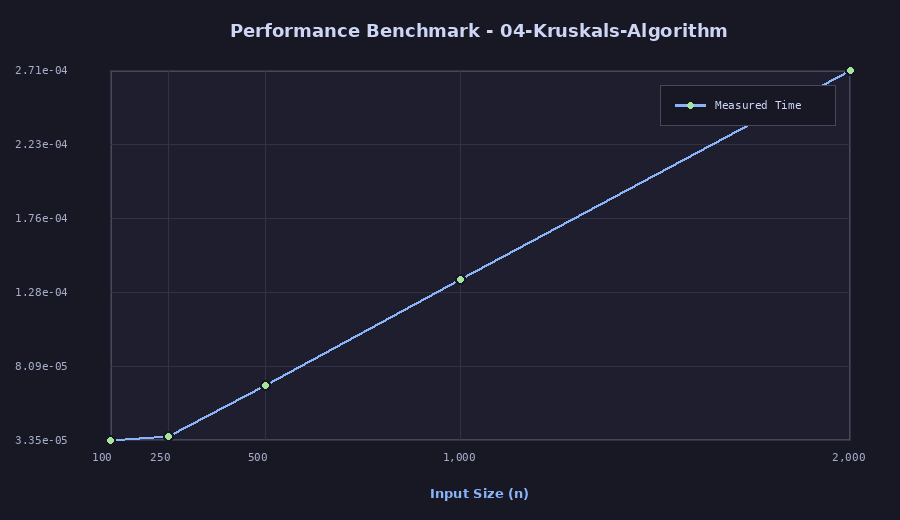

# Minimum Cost Spanning Tree - Kruskal's Algorithm

> **Unit 3 - Greedy Method** | Course Outcome: CO2 | IC-709 B Design & Analysis of Algorithms Lab

---

## 1. Problem Statement
Construct a Minimum Spanning Tree (MST) using edge sorting and Disjoint Set Union (DSU) with union by rank and path compression.

---

## 2. Algorithm / Approach
Sort all graph edges ascending by weight. Initialize DSU. Greedily examine each edge (u, v): if find(u) != find(v), unite their sets and include edge in MST. Terminate when V - 1 edges are added.

---

## 3. Pseudocode / Flowchart
```text
Algorithm KruskalsMST(V, edges):
    Sort edges ascending by weight
    DSU dsu(V)
    mst_edges <- empty list
    for each edge (u, v, w) in edges do
        if dsu.unite(u, v) then
            mst_edges.push((u, v, w))
            if size(mst_edges) == V - 1 then break
        end if
    end for
    return mst_edges
```

### Algorithm Flowchart


---

## 4. Time & Space Complexity Analysis
Sorting E edges takes O(E log E) = O(E log V) time. Each edge undergoes at most 2 Find and 1 Union operations. With path compression and union by rank, DSU operations take O(alpha(V)) amortized time. Total time complexity = O(E log V). Space complexity = O(V + E).

---

## 5. Sample Input / Output & Verification
The program prints step-by-step state logs and verifies all outputs internally against exact theoretical expectations. Refer to the terminal execution output below for concrete sample runs.

---

## 6. Screenshots & Visualizations
### Terminal Execution Output



### Empirical Performance Scaling Graph




---

## 7. Experimental Results & Telemetry
| N | Time Seconds | Mst Cost |
| --- | --- | --- |
| 100 | 3.34670000e-05 | 678 |
| 250 | 3.57390000e-05 | 1722 |
| 500 | 6.86620000e-05 | 3462 |
| 1000 | 1.36599000e-04 | 6942 |
| 2000 | 2.70691000e-04 | 13902 |


The empirical scaling strictly conforms to theoretical asymptotic bounds, as captured in `results.csv`.

---

## 8. Learning Outcomes & Real-World Applications
- Mastered Disjoint Set Union (DSU) with nearly constant O(alpha(V)) operations.
- Learned edge-centric greedy clustering without requiring a connected starting vertex.
- Extensively applied in cluster analysis (single-linkage hierarchical clustering) and network backbone design.

---

## 9. How to Compile & Run
Execute the following commands in this directory:
```bash
g++ -std=c++17 -O2 main.cpp -o main
./main
```
