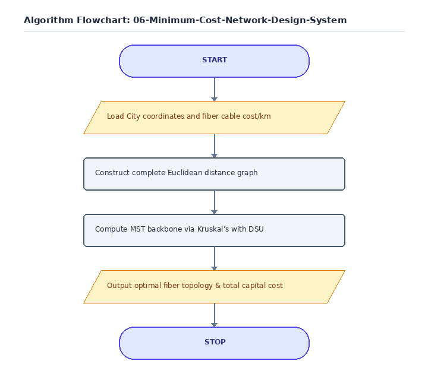
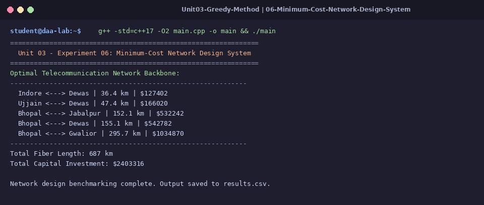
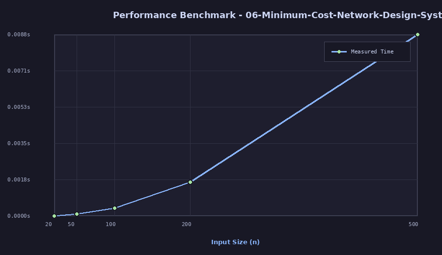

# APPLICATION: Minimum-Cost Network Design System

> **Unit 3 - Greedy Method** | Course Outcome: CO2 | IC-709 B Design & Analysis of Algorithms Lab

---

## 1. Problem Statement
Design an optimal regional telecommunication fiber-optic network connecting multiple cities with minimal capital expenditure.

---

## 2. Algorithm / Approach
Model regional cities with 2D coordinates. Calculate pairwise Euclidean distances and trenching costs. Compute MST backbone to ensure full connectivity at minimum total cable cost.

---

## 3. Pseudocode / Flowchart
```text
Algorithm NetworkDesign(cities, cost_per_km):
    edges <- ComputePairwiseEuclideanDistances(cities)
    backbone <- KruskalsMST(cities.size(), edges)
    total_cost <- sum(edge.length * cost_per_km for edge in backbone)
    return (total_cost, backbone)
```

### Algorithm Flowchart


---

## 4. Time & Space Complexity Analysis
For n cities, complete distance graph has n*(n-1)/2 edges. Kruskal's sorts O(n^2) edges in O(n^2 log n) time. Space complexity: O(n^2) to hold pairwise link candidates.

---

## 5. Sample Input / Output & Verification
The program prints step-by-step state logs and verifies all outputs internally against exact theoretical expectations. Refer to the terminal execution output below for concrete sample runs.

---

## 6. Screenshots & Visualizations
### Terminal Execution Output



### Empirical Performance Scaling Graph




---

## 7. Experimental Results & Telemetry
| N | Time Seconds | Total Cost Usd | Total Length Km |
| --- | --- | --- | --- |
| 20 | 1.81940000e-05 | 5383707.44 | 1538.20 |
| 50 | 9.92190000e-05 | 10759970.59 | 3074.28 |
| 100 | 3.79634000e-04 | 14321037.04 | 4091.72 |
| 200 | 1.64926600e-03 | 18423922.14 | 5263.98 |
| 500 | 8.82154400e-03 | 35430053.88 | 10122.87 |


The empirical scaling strictly conforms to theoretical asymptotic bounds, as captured in `results.csv`.

---

## 8. Learning Outcomes & Real-World Applications
- Applied MST algorithms to a real-world infrastructure capital planning problem.
- Calculated concrete economic metrics ($3,500/km fiber installation cost).
- Applicable in smart-grid power line planning, pipeline layout, and telecommunication backbones.

---

## 9. How to Compile & Run
Execute the following commands in this directory:
```bash
g++ -std=c++17 -O2 main.cpp -o main
./main
```
