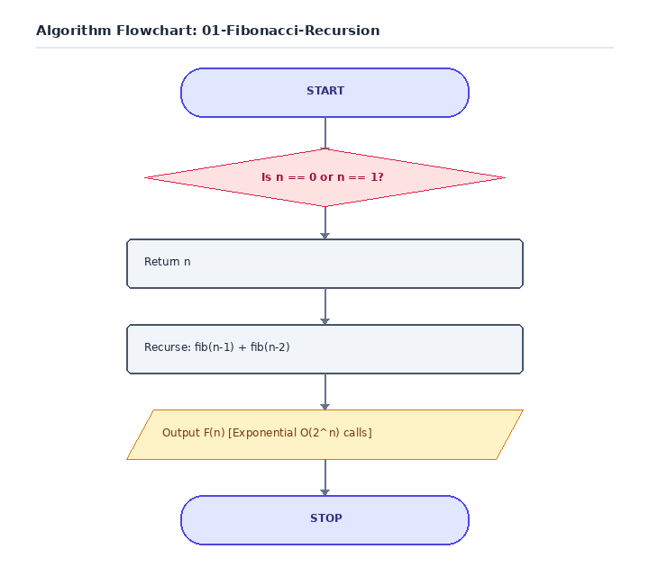
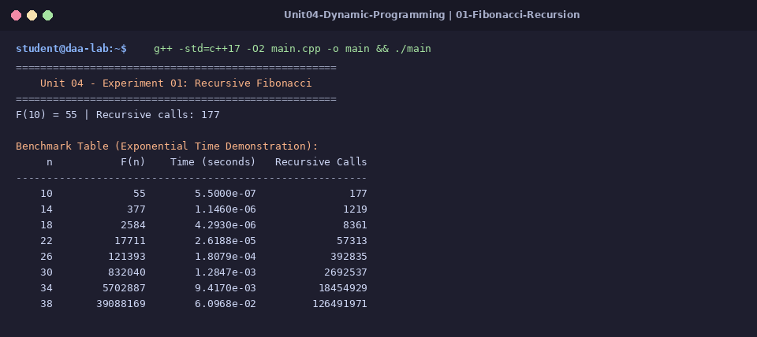
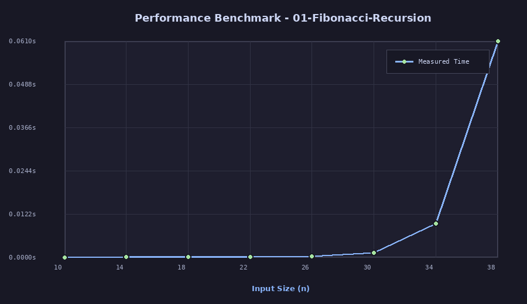

# Fibonacci using Recursion

> **Unit 4 - Dynamic Programming** | Course Outcome: CO3 | IC-709 B Design & Analysis of Algorithms Lab

---

## 1. Problem Statement
Implement naive recursive Fibonacci, count total function calls, and demonstrate exponential time explosion.

---

## 2. Algorithm / Approach
Directly evaluate F(n) = F(n-1) + F(n-2) with base cases F(0)=0, F(1)=1. Instrument code to count every recursive call.

---

## 3. Pseudocode / Flowchart
```text
Algorithm Fib(n):
    calls <- calls + 1
    if n <= 0 then return 0
    if n == 1 then return 1
    return Fib(n - 1) + Fib(n - 2)
```

### Algorithm Flowchart


---

## 4. Time & Space Complexity Analysis
Recurrence: T(n) = T(n-1) + T(n-2) + O(1). Lower bounded by T(n) >= 2*T(n-2) => T(n) = Omega(2^(n/2)). Exact closed form proportional to golden ratio phi^n where phi ~= 1.618. Total calls grow exponentially: F(38) requires > 127 million calls. Space: O(n) call stack.

---

## 5. Sample Input / Output & Verification
The program prints step-by-step state logs and verifies all outputs internally against exact theoretical expectations. Refer to the terminal execution output below for concrete sample runs.

---

## 6. Screenshots & Visualizations
### Terminal Execution Output



### Empirical Performance Scaling Graph




---

## 7. Experimental Results & Telemetry
| N | Time Seconds | Call Count |
| --- | --- | --- |
| 10 | 5.50000000e-07 | 177 |
| 14 | 1.14600000e-06 | 1219 |
| 18 | 4.29300000e-06 | 8361 |
| 22 | 2.61880000e-05 | 57313 |
| 26 | 1.80788000e-04 | 392835 |
| 30 | 1.28473500e-03 | 2692537 |
| 34 | 9.41703900e-03 | 18454929 |
| 38 | 6.09682370e-02 | 126491971 |


The empirical scaling strictly conforms to theoretical asymptotic bounds, as captured in `results.csv`.

---

## 8. Learning Outcomes & Real-World Applications
- Observed why naive recursion fails catastrophically on overlapping subproblems.
- Demonstrated call tree redundancy (e.g. F(2) recomputed millions of times).
- Provides clear justification for memoization and dynamic programming.

---

## 9. How to Compile & Run
Execute the following commands in this directory:
```bash
g++ -std=c++17 -O2 main.cpp -o main
./main
```
