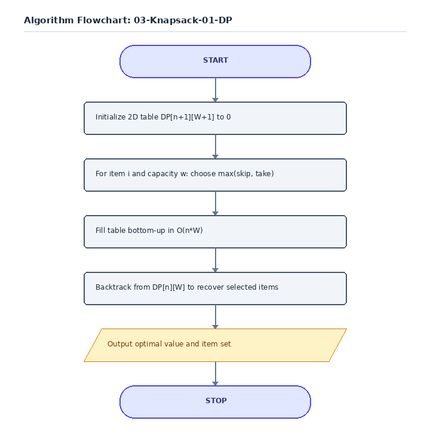
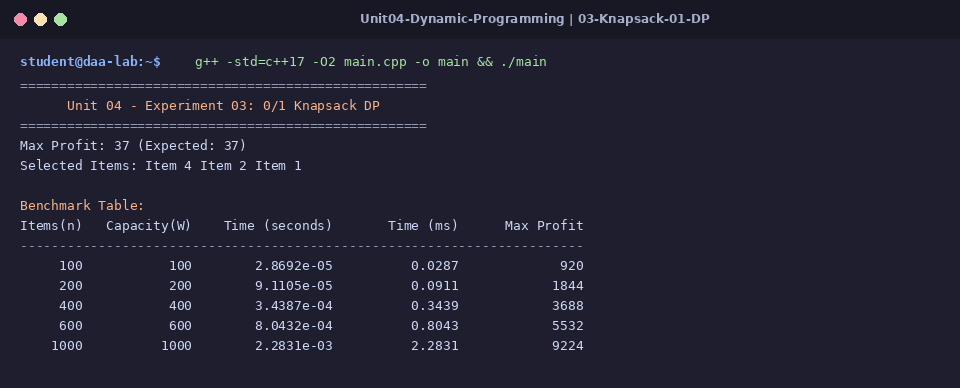
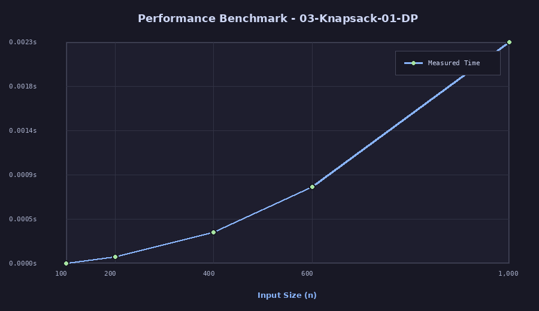

# 0/1 Knapsack using Dynamic Programming

> **Unit 4 - Dynamic Programming** | Course Outcome: CO3 | IC-709 B Design & Analysis of Algorithms Lab

---

## 1. Problem Statement
Implement 0/1 Knapsack using dynamic programming table and backtrack to retrieve the exact subset of chosen items.

---

## 2. Algorithm / Approach
Construct 2D DP table DP[n+1][W+1] where DP[i][w] represents max profit achievable using a subset of first i items within capacity w. Backtrack from DP[n][W] to recover selected items.

---

## 3. Pseudocode / Flowchart
```text
Algorithm Knapsack01DP(items, W):
    Initialize DP[n+1][W+1] to 0
    for i <- 1 to n do
        for w <- 0 to W do
            if items[i-1].weight <= w then
                DP[i][w] <- max(DP[i-1][w], items[i-1].val + DP[i-1][w - items[i-1].weight])
            else
                DP[i][w] <- DP[i-1][w]
            end if
        end for
    end for
    return DP[n][W]
```

### Algorithm Flowchart


---

## 4. Time & Space Complexity Analysis
Table dimensions are (n + 1) x (W + 1). Each cell evaluates in O(1) time. Total time complexity = O(n * W) (pseudo-polynomial). Space complexity = O(n * W) for item reconstruction, or O(W) if only max profit is required.

---

## 5. Sample Input / Output & Verification
The program prints step-by-step state logs and verifies all outputs internally against exact theoretical expectations. Refer to the terminal execution output below for concrete sample runs.

---

## 6. Screenshots & Visualizations
### Terminal Execution Output



### Empirical Performance Scaling Graph




---

## 7. Experimental Results & Telemetry
| N | W | Time Seconds | Time Ms | Max Profit |
| --- | --- | --- | --- | --- |
| 100 | 100 | 2.86920000e-05 | 0.0287 | 920 |
| 200 | 200 | 9.11050000e-05 | 0.0911 | 1844 |
| 400 | 400 | 3.43875000e-04 | 0.3439 | 3688 |
| 600 | 600 | 8.04316000e-04 | 0.8043 | 5532 |
| 1000 | 1000 | 2.28306400e-03 | 2.2831 | 9224 |


The empirical scaling strictly conforms to theoretical asymptotic bounds, as captured in `results.csv`.

---

## 8. Learning Outcomes & Real-World Applications
- Mastered 2D state transitions and backtracking table recovery.
- Understood why 0/1 Knapsack is NP-Complete yet efficiently solvable when W is moderate (pseudo-polynomial).
- Applied in cargo packing, budget allocation, and virtual machine capacity scheduling.

---

## 9. How to Compile & Run
Execute the following commands in this directory:
```bash
g++ -std=c++17 -O2 main.cpp -o main
./main
```
