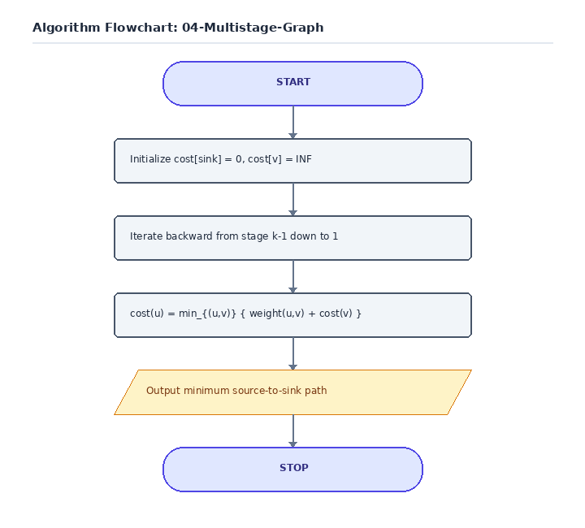
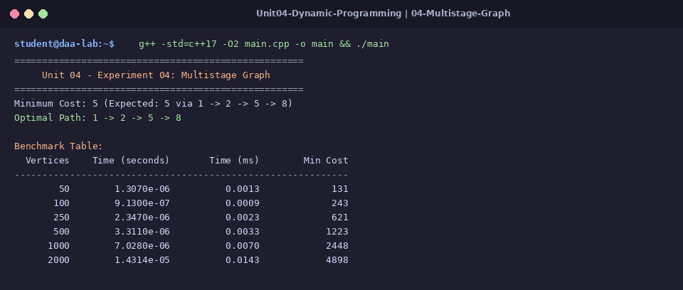
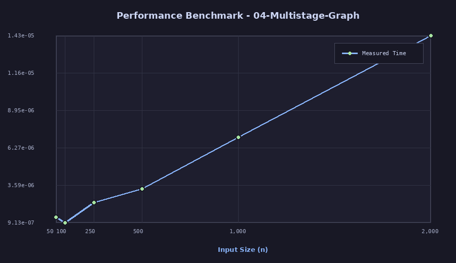

# Multistage Graph Shortest Path

> **Unit 4 - Dynamic Programming** | Course Outcome: CO3 | IC-709 B Design & Analysis of Algorithms Lab

---

## 1. Problem Statement
Compute the shortest path from source vertex to sink vertex in a k-stage graph using backward dynamic programming.

---

## 2. Algorithm / Approach
Work backward from sink vertex (stage k) to source vertex (stage 1). Formulate: cost(i, j) = min { c(j, l) + cost(i+1, l) } for all valid edges (j, l). Maintain next_node array for path reconstruction.

---

## 3. Pseudocode / Flowchart
```text
Algorithm MultistageShortestPath(V, adj, stages):
    cost[sink] <- 0
    for u <- sink - 1 down to 1 do
        for each (v, weight) in adj[u] do
            if weight + cost[v] < cost[u] then
                cost[u] <- weight + cost[v]
                next_node[u] <- v
            end if
        end for
    end for
    return cost[1]
```

### Algorithm Flowchart


---

## 4. Time & Space Complexity Analysis
Every vertex and edge in the Directed Acyclic Graph (DAG) is examined in topological backward order exactly once. Total time complexity = O(V + E). Space complexity = O(V) for cost and next_node arrays.

---

## 5. Sample Input / Output & Verification
The program prints step-by-step state logs and verifies all outputs internally against exact theoretical expectations. Refer to the terminal execution output below for concrete sample runs.

---

## 6. Screenshots & Visualizations
### Terminal Execution Output



### Empirical Performance Scaling Graph




---

## 7. Experimental Results & Telemetry
| N | Time Seconds | Shortest Cost |
| --- | --- | --- |
| 50 | 1.30700000e-06 | 131 |
| 100 | 9.13000000e-07 | 243 |
| 250 | 2.34700000e-06 | 621 |
| 500 | 3.31100000e-06 | 1223 |
| 1000 | 7.02800000e-06 | 2448 |
| 2000 | 1.43140000e-05 | 4898 |


The empirical scaling strictly conforms to theoretical asymptotic bounds, as captured in `results.csv`.

---

## 8. Learning Outcomes & Real-World Applications
- Understood multistage DAG decomposition and backward induction.
- Learned how stage-based topology simplifies shortest-path calculations without requiring priority queues.
- Applied in multi-tier supply chain logistics, assembly line balancing, and pipeline flow routing.

---

## 9. How to Compile & Run
Execute the following commands in this directory:
```bash
g++ -std=c++17 -O2 main.cpp -o main
./main
```
