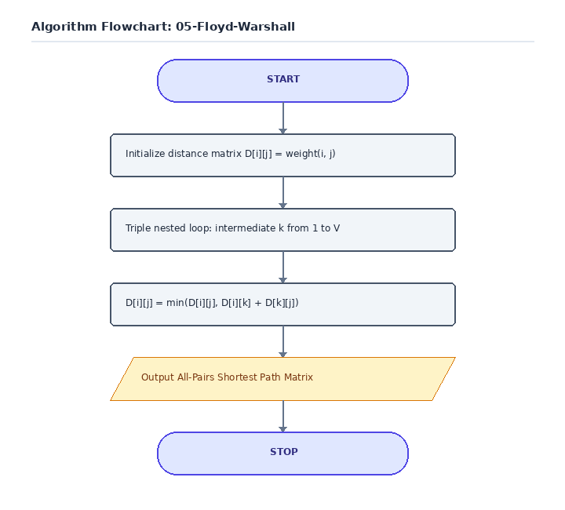
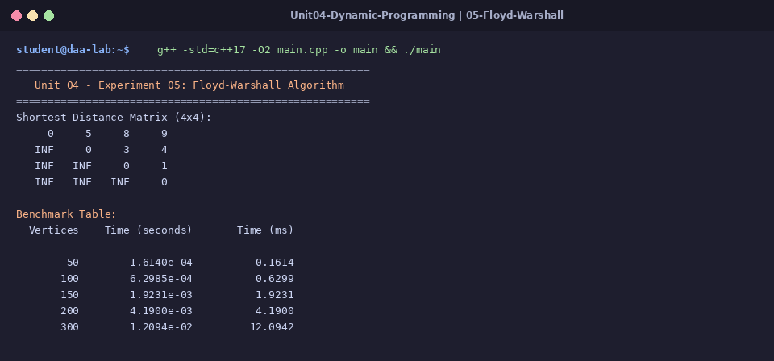
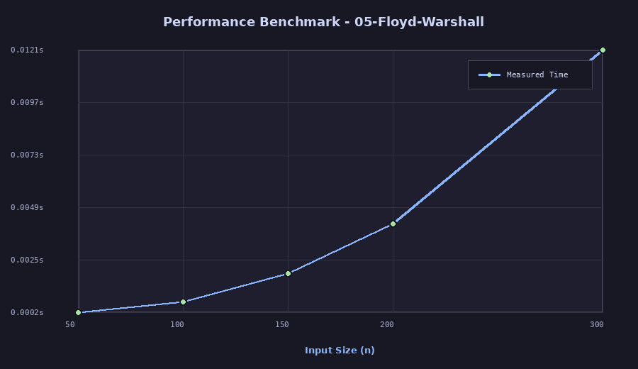

# All-Pairs Shortest Path (Floyd-Warshall)

> **Unit 4 - Dynamic Programming** | Course Outcome: CO3 | IC-709 B Design & Analysis of Algorithms Lab

---

## 1. Problem Statement
Compute shortest path distances between all pairs of vertices in an arbitrary directed graph with positive or negative edges.

---

## 2. Algorithm / Approach
Dynamic programming with intermediate vertex relaxation. In stage k, check if path through vertex k yields a shorter path: dist[i][j] = min(dist[i][j], dist[i][k] + dist[k][j]).

---

## 3. Pseudocode / Flowchart
```text
Algorithm FloydWarshall(dist, V):
    for k <- 0 to V - 1 do
        for i <- 0 to V - 1 do
            for j <- 0 to V - 1 do
                if dist[i][k] != INF and dist[k][j] != INF then
                    dist[i][j] <- min(dist[i][j], dist[i][k] + dist[k][j])
                end if
            end for
        end for
    end for
    return dist
```

### Algorithm Flowchart


---

## 4. Time & Space Complexity Analysis
Three nested loops from 0 to V - 1. Total time complexity = Theta(V^3). Space complexity = Theta(V^2) for the 2D distance matrix. Can detect negative cycles if dist[i][i] < 0.

---

## 5. Sample Input / Output & Verification
The program prints step-by-step state logs and verifies all outputs internally against exact theoretical expectations. Refer to the terminal execution output below for concrete sample runs.

---

## 6. Screenshots & Visualizations
### Terminal Execution Output



### Empirical Performance Scaling Graph




---

## 7. Experimental Results & Telemetry
| N | Time Seconds | Time Ms |
| --- | --- | --- |
| 50 | 1.61398000e-04 | 0.1614 |
| 100 | 6.29851000e-04 | 0.6299 |
| 150 | 1.92307500e-03 | 1.9231 |
| 200 | 4.19001100e-03 | 4.1900 |
| 300 | 1.20942450e-02 | 12.0942 |


The empirical scaling strictly conforms to theoretical asymptotic bounds, as captured in `results.csv`.

---

## 8. Learning Outcomes & Real-World Applications
- Mastered all-pairs distance matrix construction with dynamic intermediate vertex relaxation.
- Learned negative cycle detection capability.
- Applied in network routing protocols (RIP), traffic navigation systems, and transitive closure computation.

---

## 9. How to Compile & Run
Execute the following commands in this directory:
```bash
g++ -std=c++17 -O2 main.cpp -o main
./main
```
