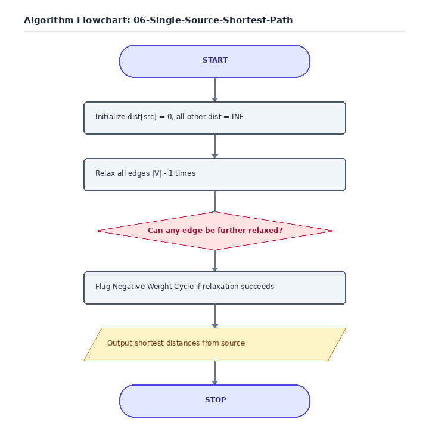
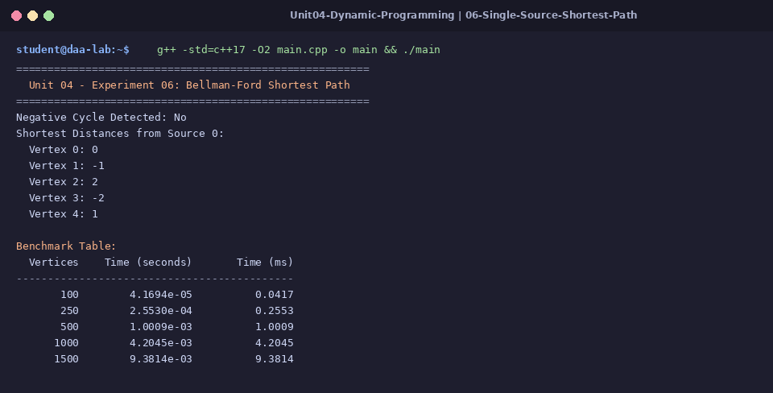
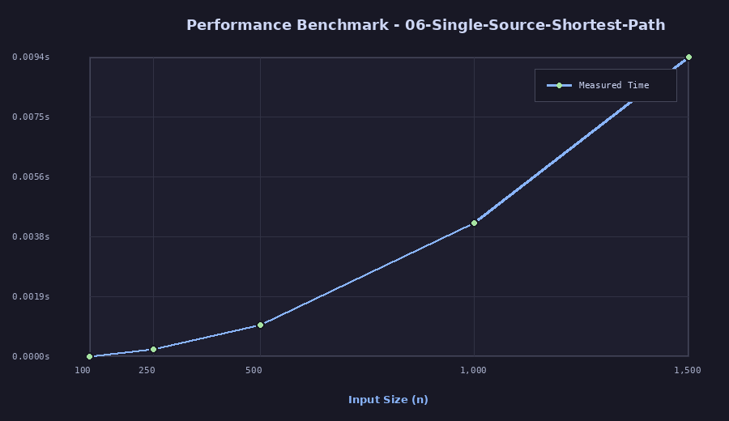

# Single-Source Shortest Path (Bellman-Ford DP)

> **Unit 4 - Dynamic Programming** | Course Outcome: CO3 | IC-709 B Design & Analysis of Algorithms Lab

---

## 1. Problem Statement
Find shortest paths from a single source to all vertices in graphs containing negative edge weights and detect negative cycles.

---

## 2. Algorithm / Approach
Relax all graph edges |V| - 1 times. If any edge can still be relaxed in the V-th iteration, a negative weight cycle exists.

---

## 3. Pseudocode / Flowchart
```text
Algorithm BellmanFord(V, edges, src):
    dist <- array of size V filled with INF, dist[src] <- 0
    for i <- 1 to V - 1 do
        for each edge (u, v, w) in edges do
            if dist[u] != INF and dist[u] + w < dist[v] then
                dist[v] <- dist[u] + w
            end if
        end for
    end for
    // Check negative cycle
    for each edge (u, v, w) in edges do
        if dist[u] != INF and dist[u] + w < dist[v] then
            return "Negative Cycle Detected"
        end if
    end for
    return dist
```

### Algorithm Flowchart


---

## 4. Time & Space Complexity Analysis
Outer loop executes V - 1 times; inner loop iterates over all E edges. Total time complexity = O(V * E). Space complexity = O(V) for the distance array.

---

## 5. Sample Input / Output & Verification
The program prints step-by-step state logs and verifies all outputs internally against exact theoretical expectations. Refer to the terminal execution output below for concrete sample runs.

---

## 6. Screenshots & Visualizations
### Terminal Execution Output



### Empirical Performance Scaling Graph




---

## 7. Experimental Results & Telemetry
| N | Time Seconds | Time Ms |
| --- | --- | --- |
| 100 | 4.16940000e-05 | 0.0417 |
| 250 | 2.55296000e-04 | 0.2553 |
| 500 | 1.00091000e-03 | 1.0009 |
| 1000 | 4.20451700e-03 | 4.2045 |
| 1500 | 9.38142100e-03 | 9.3814 |


The empirical scaling strictly conforms to theoretical asymptotic bounds, as captured in `results.csv`.

---

## 8. Learning Outcomes & Real-World Applications
- Understood why Dijkstra's algorithm fails on negative weights while Bellman-Ford succeeds.
- Implemented negative-weight cycle detection.
- Applied in distance-vector routing (BGP/RIP protocols) and currency arbitrage detection.

---

## 9. How to Compile & Run
Execute the following commands in this directory:
```bash
g++ -std=c++17 -O2 main.cpp -o main
./main
```
