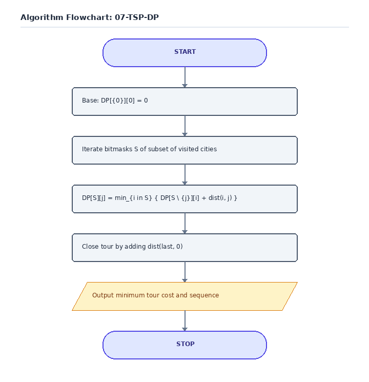
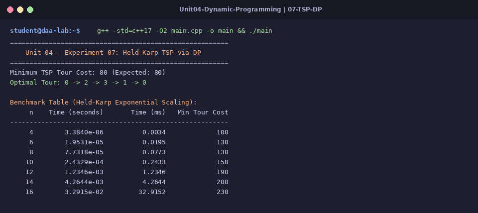
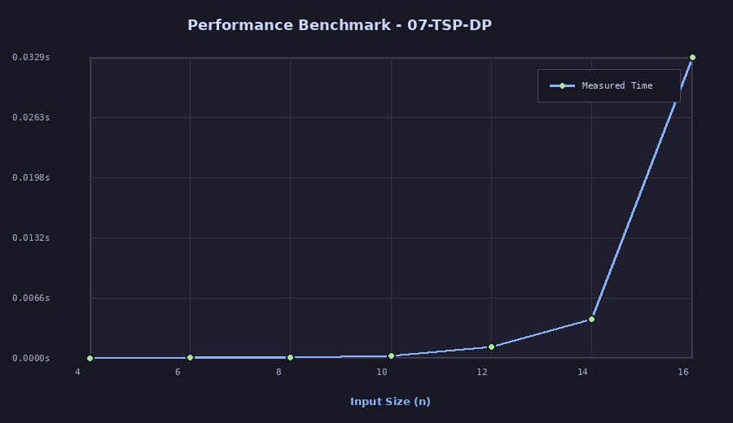

# Traveling Salesperson Problem using DP (Held-Karp)

> **Unit 4 - Dynamic Programming** | Course Outcome: CO3 | IC-709 B Design & Analysis of Algorithms Lab

---

## 1. Problem Statement
Solve the Traveling Salesperson Problem to exact optimality using Held-Karp dynamic programming with bitmasking.

---

## 2. Algorithm / Approach
Represent subsets of visited cities using bitmask integers. DP[mask][u] stores min cost to visit subset mask ending at city u. Transition: DP[mask | (1<<v)][v] = min(DP[mask][u] + dist[u][v]).

---

## 3. Pseudocode / Flowchart
```text
Algorithm HeldKarpTSP(dist, n):
    Initialize DP[1 << n][n] to INF
    DP[1][0] <- 0
    for mask <- 1 to (1 << n) - 1 do
        for u <- 0 to n - 1 do
            if not (mask & (1 << u)) then continue
            for v <- 0 to n - 1 do
                if not (mask & (1 << v)) then
                    DP[mask | (1 << v)][v] <- min(DP[mask | (1 << v)][v], DP[mask][u] + dist[u][v])
                end if
            end for
        end for
    end for
    return min_{u=1}^{n-1} (DP[(1<<n)-1][u] + dist[u][0])
```

### Algorithm Flowchart


---

## 4. Time & Space Complexity Analysis
Number of subproblems is 2^n * n. Each subproblem takes O(n) transitions. Total time complexity = O(n^2 * 2^n). This provides massive exponential speedup over naive O(n!) permutation search. Space complexity = O(n * 2^n).

---

## 5. Sample Input / Output & Verification
The program prints step-by-step state logs and verifies all outputs internally against exact theoretical expectations. Refer to the terminal execution output below for concrete sample runs.

---

## 6. Screenshots & Visualizations
### Terminal Execution Output



### Empirical Performance Scaling Graph




---

## 7. Experimental Results & Telemetry
| N | Time Seconds | Time Ms | Tour Cost |
| --- | --- | --- | --- |
| 4 | 3.38400000e-06 | 0.0034 | 100 |
| 6 | 1.95310000e-05 | 0.0195 | 130 |
| 8 | 7.73180000e-05 | 0.0773 | 130 |
| 10 | 2.43292000e-04 | 0.2433 | 150 |
| 12 | 1.23456600e-03 | 1.2346 | 190 |
| 14 | 4.26444000e-03 | 4.2644 | 200 |
| 16 | 3.29152450e-02 | 32.9152 | 230 |


The empirical scaling strictly conforms to theoretical asymptotic bounds, as captured in `results.csv`.

---

## 8. Learning Outcomes & Real-World Applications
- Mastered state compression dynamic programming using bitmask representations.
- Demonstrated reduction from O(n!) to O(n^2 2^n).
- Applied in circuit board drilling, logistics dispatching, and robotic arm trajectory planning.

---

## 9. How to Compile & Run
Execute the following commands in this directory:
```bash
g++ -std=c++17 -O2 main.cpp -o main
./main
```
