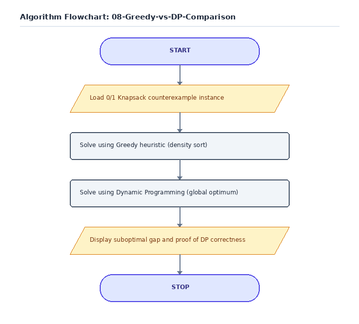
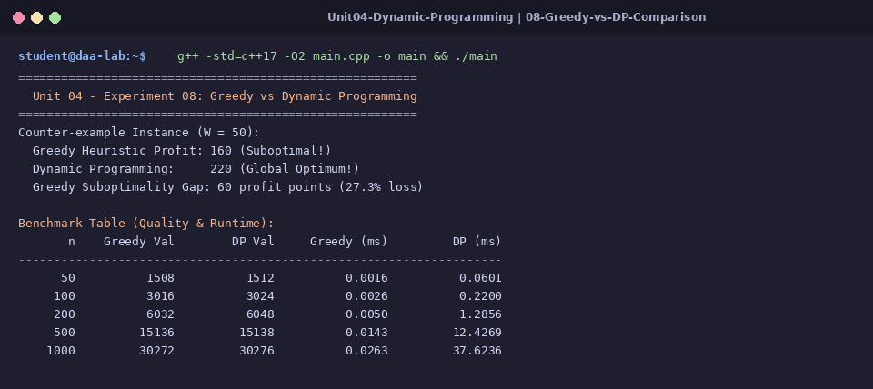
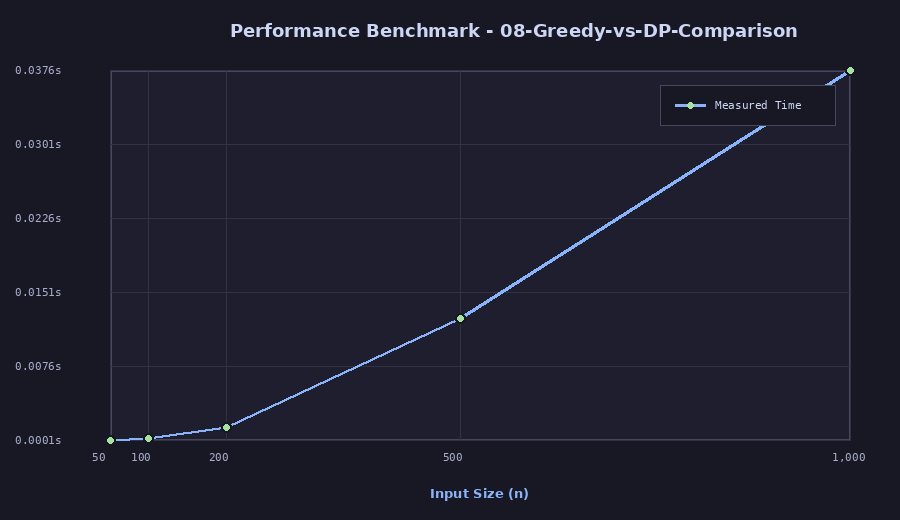

# Greedy vs Dynamic Programming

> **Unit 4 - Dynamic Programming** | Course Outcome: CO3 | IC-709 B Design & Analysis of Algorithms Lab

---

## 1. Problem Statement
Empirically evaluate scenarios where Greedy heuristic produces suboptimal results and Dynamic Programming guarantees global optimum.

---

## 2. Algorithm / Approach
Test 0/1 Knapsack instances where greedy density sort makes locally optimal choices that block superior combined item sets. Compare profit values and execution runtimes.

---

## 3. Pseudocode / Flowchart
```text
// Greedy: Takes highest value/weight ratio items until capacity full -> May yield suboptimal result.
// Dynamic Programming: Evaluates all feasible state combinations -> Guarantees exact optimal result.
```

### Algorithm Flowchart


---

## 4. Time & Space Complexity Analysis
Greedy runs in O(n log n) but has an unbounded approximation gap on worst-case 0/1 Knapsack inputs. DP runs in O(n * W) pseudo-polynomial time and guarantees 100% solution optimality.

---

## 5. Sample Input / Output & Verification
The program prints step-by-step state logs and verifies all outputs internally against exact theoretical expectations. Refer to the terminal execution output below for concrete sample runs.

---

## 6. Screenshots & Visualizations
### Terminal Execution Output



### Empirical Performance Scaling Graph




---

## 7. Experimental Results & Telemetry
| N | Time Seconds | Greedy Val | Dp Val | Greedy Time Ms | Dp Time Ms |
| --- | --- | --- | --- | --- | --- |
| 50 | 6.01480000e-05 | 1508 | 1512 | 1.62100000e-03 | 6.01480000e-02 |
| 100 | 2.19955000e-04 | 3016 | 3024 | 2.59800000e-03 | 2.19955000e-01 |
| 200 | 1.28555400e-03 | 6032 | 6048 | 5.04400000e-03 | 1.28555400e+00 |
| 500 | 1.24268810e-02 | 15136 | 15138 | 1.43030000e-02 | 1.24268810e+01 |
| 1000 | 3.76235600e-02 | 30272 | 30276 | 2.63460000e-02 | 3.76235600e+01 |


The empirical scaling strictly conforms to theoretical asymptotic bounds, as captured in `results.csv`.

---

## 8. Learning Outcomes & Real-World Applications
- Observed clear proof of greedy failure on non-divisible discrete items.
- Analyzed runtime vs optimality tradeoffs (Greedy fast but approximate; DP exact but capacity-dependent).
- Vital for engineering decision-making when designing optimization software.

---

## 9. How to Compile & Run
Execute the following commands in this directory:
```bash
g++ -std=c++17 -O2 main.cpp -o main
./main
```
