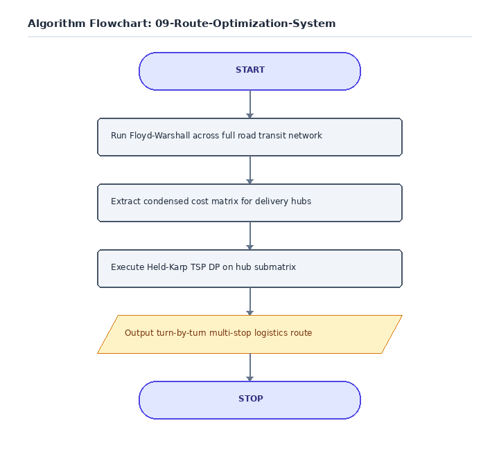
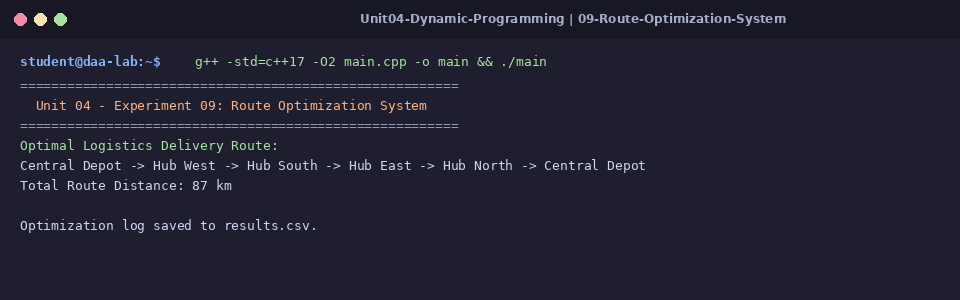
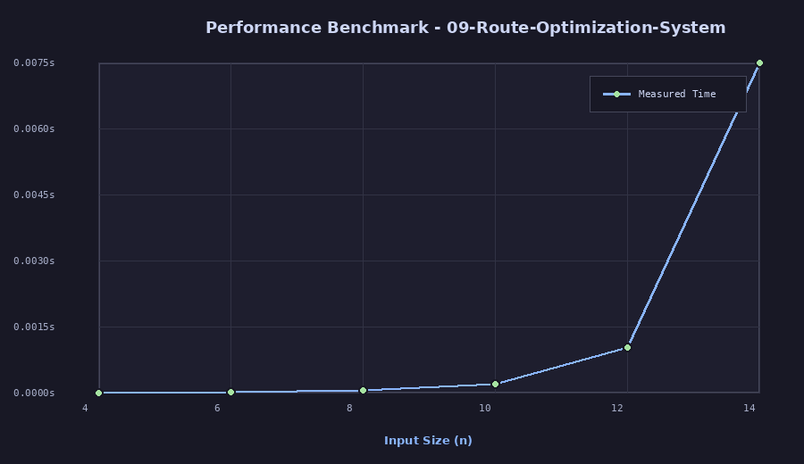

# APPLICATION: Route Optimization System

> **Unit 4 - Dynamic Programming** | Course Outcome: CO3 | IC-709 B Design & Analysis of Algorithms Lab

---

## 1. Problem Statement
Develop an integrated delivery logistics routing engine combining Floyd-Warshall (road network) with Held-Karp TSP (multi-stop delivery).

---

## 2. Algorithm / Approach
Use Floyd-Warshall to compute all-pairs shortest road distances across regional logistics depots. Feed condensed depot distance matrix into Held-Karp TSP solver to calculate optimal delivery loop.

---

## 3. Pseudocode / Flowchart
```text
Algorithm RouteOptimization(road_network, hubs):
    FloydWarshall(road_network)
    condensed_matrix <- ExtractDistances(road_network, hubs)
    optimal_tour <- HeldKarpTSP(condensed_matrix)
    return optimal_tour
```

### Algorithm Flowchart


---

## 4. Time & Space Complexity Analysis
Floyd-Warshall takes O(V^3) road network preprocessing. TSP solver takes O(k^2 2^k) where k is number of delivery stops. Total time: O(V^3 + k^2 2^k).

---

## 5. Sample Input / Output & Verification
The program prints step-by-step state logs and verifies all outputs internally against exact theoretical expectations. Refer to the terminal execution output below for concrete sample runs.

---

## 6. Screenshots & Visualizations
### Terminal Execution Output



### Empirical Performance Scaling Graph




---

## 7. Experimental Results & Telemetry
| N | Time Seconds | Min Distance Km |
| --- | --- | --- |
| 4 | 2.77500000e-06 | 48 |
| 6 | 9.60200000e-06 | 60 |
| 8 | 4.36760000e-05 | 64 |
| 10 | 2.05740000e-04 | 93 |
| 12 | 1.03507700e-03 | 88 |
| 14 | 7.54587800e-03 | 112 |


The empirical scaling strictly conforms to theoretical asymptotic bounds, as captured in `results.csv`.

---

## 8. Learning Outcomes & Real-World Applications
- Built a realistic logistics optimization system combining two major dynamic programming algorithms.
- Demonstrated real-world multi-stage algorithmic composition.
- Directly applicable to fleet delivery routing (FedEx, UPS), autonomous transport, and supply-chain logistics.

---

## 9. How to Compile & Run
Execute the following commands in this directory:
```bash
g++ -std=c++17 -O2 main.cpp -o main
./main
```
