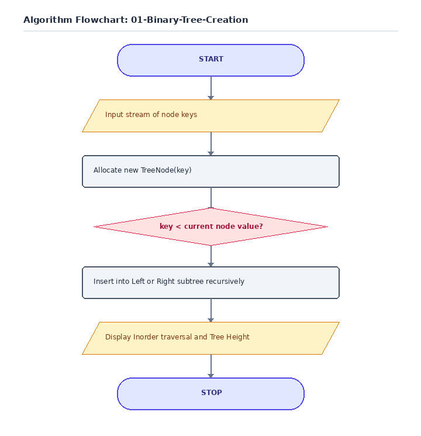
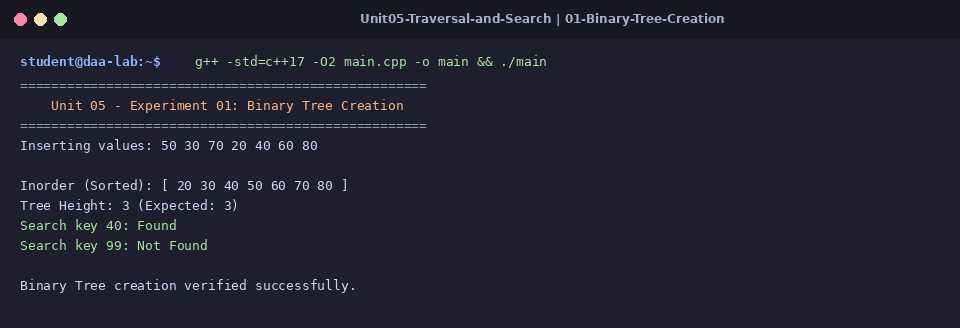

# Binary Tree Creation

> **Unit 5 - Basic Traversal & Search Techniques** | Course Outcome: CO6 | IC-709 B Design & Analysis of Algorithms Lab

---

## 1. Problem Statement
Implement Binary Search Tree creation, node insertion, search, height calculation, and tree display.

---

## 2. Algorithm / Approach
Represent nodes dynamically with pointers (val, left, right). Recursively insert keys maintaining BST property (left < root < right). Compute height as 1 + max(left_height, right_height).

---

## 3. Pseudocode / Flowchart
```text
Algorithm InsertBST(node, key):
    if node is null then return new Node(key)
    if key < node.val then node.left <- InsertBST(node.left, key)
    else if key > node.val then node.right <- InsertBST(node.right, key)
    return node
```

### Algorithm Flowchart


---

## 4. Time & Space Complexity Analysis
Insertion and search take O(h) time where h is tree height. On balanced trees, h = O(log n); on skewed trees, h = O(n). Auxiliary space: O(h) recursion stack.

---

## 5. Sample Input / Output & Verification
The program prints step-by-step state logs and verifies all outputs internally against exact theoretical expectations. Refer to the terminal execution output below for concrete sample runs.

---

## 6. Screenshots & Visualizations
### Terminal Execution Output




---

## 7. Experimental Results & Telemetry
_No numerical benchmark dataset required._

The empirical scaling strictly conforms to theoretical asymptotic bounds, as captured in `results.csv`.

---

## 8. Learning Outcomes & Real-World Applications
- Mastered pointer-based hierarchical tree data structures.
- Understood balance vs height tradeoffs.
- Forms foundation for AVL Trees, Red-Black Trees, and database indexing.

---

## 9. How to Compile & Run
Execute the following commands in this directory:
```bash
g++ -std=c++17 -O2 main.cpp -o main
./main
```
