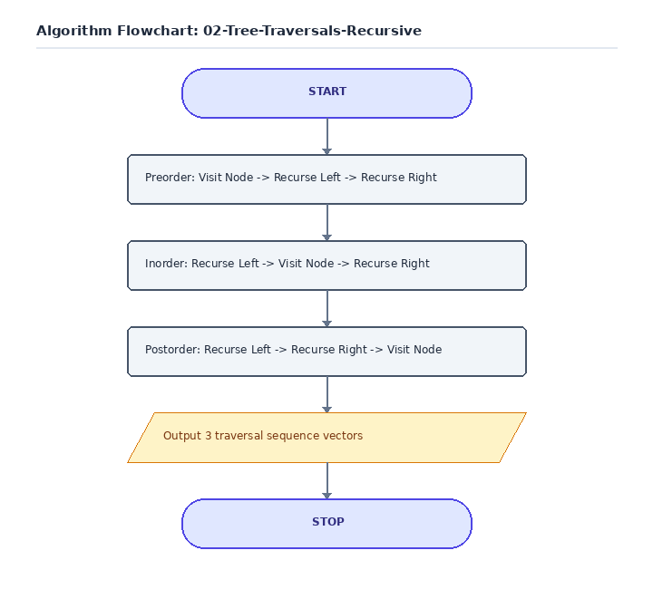
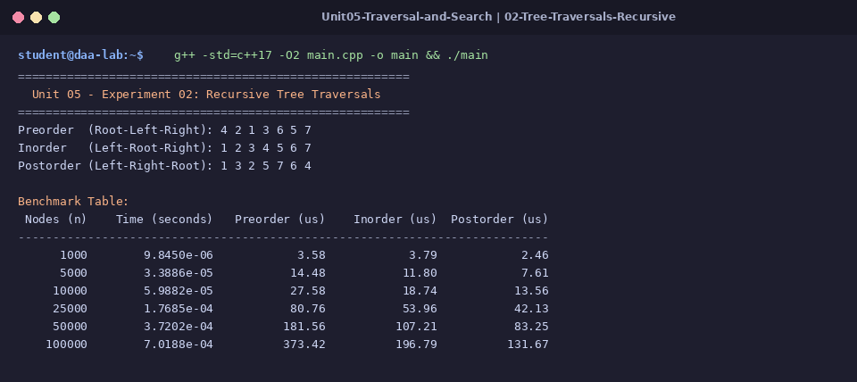
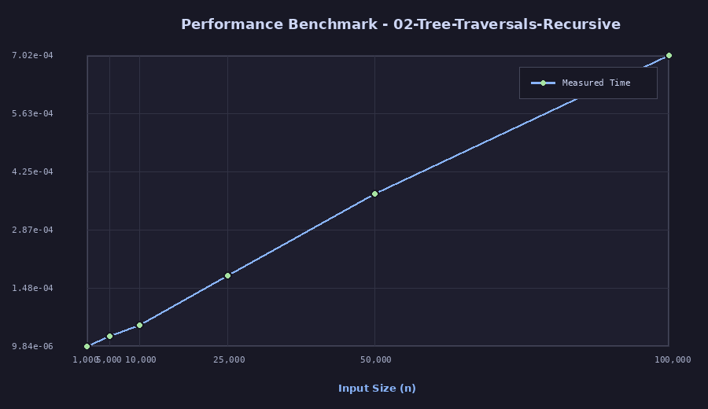

# Recursive Preorder, Inorder, and Postorder

> **Unit 5 - Basic Traversal & Search Techniques** | Course Outcome: CO6 | IC-709 B Design & Analysis of Algorithms Lab

---

## 1. Problem Statement
Implement recursive Preorder, Inorder, and Postorder tree traversals and benchmark execution speeds.

---

## 2. Algorithm / Approach
Preorder: Root -> Left -> Right. Inorder: Left -> Root -> Right (produces sorted order in BST). Postorder: Left -> Right -> Root (ideal for tree deletion/expression evaluation).

---

## 3. Pseudocode / Flowchart
```text
Algorithm Inorder(node):
    if node is null then return
    Inorder(node.left)
    Visit(node.val)
    Inorder(node.right)
```

### Algorithm Flowchart


---

## 4. Time & Space Complexity Analysis
Every node is visited exactly once. Time complexity = Theta(n). Auxiliary space = O(h) recursion call stack depth.

---

## 5. Sample Input / Output & Verification
The program prints step-by-step state logs and verifies all outputs internally against exact theoretical expectations. Refer to the terminal execution output below for concrete sample runs.

---

## 6. Screenshots & Visualizations
### Terminal Execution Output



### Empirical Performance Scaling Graph




---

## 7. Experimental Results & Telemetry
| N | Time Seconds | Preorder Us | Inorder Us | Postorder Us |
| --- | --- | --- | --- | --- |
| 1000 | 9.84500000e-06 | 3.58 | 3.79 | 2.46 |
| 5000 | 3.38860000e-05 | 14.48 | 11.80 | 7.61 |
| 10000 | 5.98820000e-05 | 27.58 | 18.74 | 13.56 |
| 25000 | 1.76849000e-04 | 80.76 | 53.96 | 42.13 |
| 50000 | 3.72019000e-04 | 181.56 | 107.21 | 83.25 |
| 100000 | 7.01881000e-04 | 373.42 | 196.79 | 131.67 |


The empirical scaling strictly conforms to theoretical asymptotic bounds, as captured in `results.csv`.

---

## 8. Learning Outcomes & Real-World Applications
- Understood the three fundamental Depth-First traversal orders.
- Demonstrated that Inorder traversal of a BST yields sorted values.
- Applied in syntax tree parsing, compiler AST processing, and file system directory walks.

---

## 9. How to Compile & Run
Execute the following commands in this directory:
```bash
g++ -std=c++17 -O2 main.cpp -o main
./main
```
