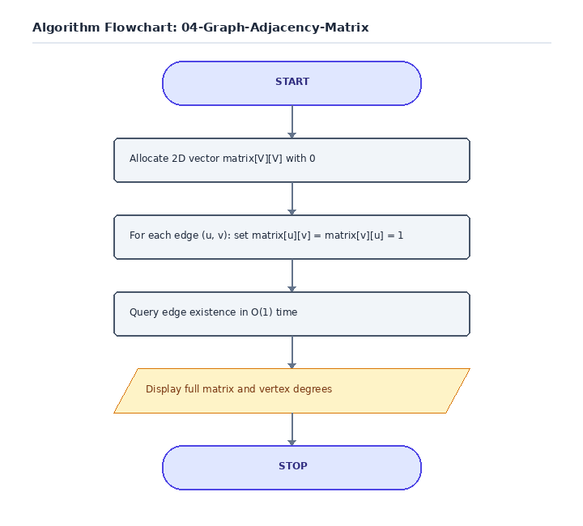
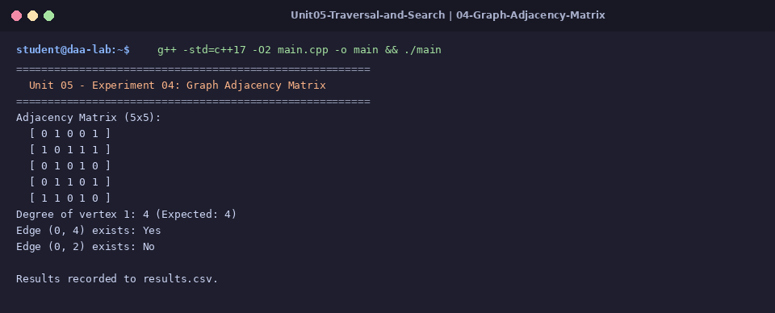
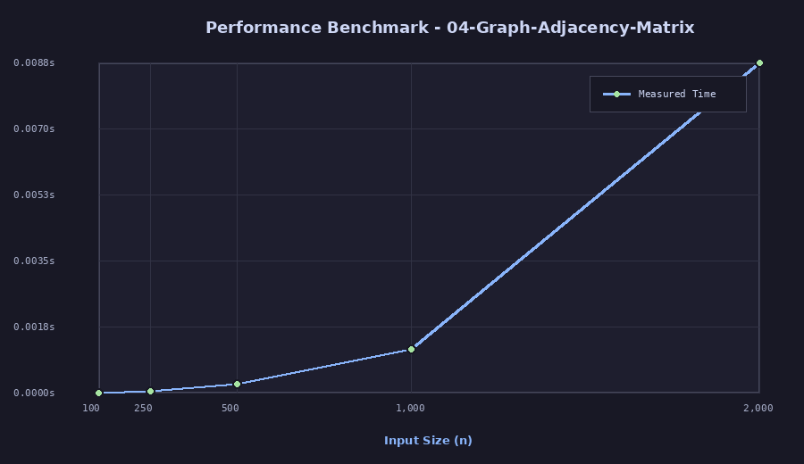

# Graph using Adjacency Matrix

> **Unit 5 - Basic Traversal & Search Techniques** | Course Outcome: CO6 | IC-709 B Design & Analysis of Algorithms Lab

---

## 1. Problem Statement
Implement 2D Adjacency Matrix representation, edge insertion, edge queries, and degree calculations.

---

## 2. Algorithm / Approach
Allocate a 2D vector matrix[V][V]. Set matrix[u][v] = 1 for edge existence. Edge query takes O(1) time.

---

## 3. Pseudocode / Flowchart
```text
Class GraphAdjMatrix(V):
    matrix <- 2D array [V][V] initialized to 0
    Method AddEdge(u, v): matrix[u][v] <- 1; matrix[v][u] <- 1
    Method HasEdge(u, v): return matrix[u][v] != 0
    Method Degree(u): return sum_{j=0}^{V-1} matrix[u][j]
```

### Algorithm Flowchart


---

## 4. Time & Space Complexity Analysis
Space complexity: Theta(V^2) regardless of edge count. Edge check: O(1). Neighbor enumeration: Theta(V). Best suited for dense graphs where E ~ V^2.

---

## 5. Sample Input / Output & Verification
The program prints step-by-step state logs and verifies all outputs internally against exact theoretical expectations. Refer to the terminal execution output below for concrete sample runs.

---

## 6. Screenshots & Visualizations
### Terminal Execution Output



### Empirical Performance Scaling Graph




---

## 7. Experimental Results & Telemetry
| N | Time Seconds | Memory Kb |
| --- | --- | --- |
| 100 | 2.18640000e-05 | 39.1 |
| 250 | 6.21420000e-05 | 244.1 |
| 500 | 2.41275000e-04 | 976.6 |
| 1000 | 1.17136000e-03 | 3906.2 |
| 2000 | 8.78109300e-03 | 15625.0 |


The empirical scaling strictly conforms to theoretical asymptotic bounds, as captured in `results.csv`.

---

## 8. Learning Outcomes & Real-World Applications
- Understood O(1) edge lookup advantages in dense graphs.
- Recognized severe space penalty on large sparse graphs (e.g. 1 million vertices requires 4 Terabytes).
- Applied in dense network flow, GPU matrix algorithms, and algebraic graph theory.

---

## 9. How to Compile & Run
Execute the following commands in this directory:
```bash
g++ -std=c++17 -O2 main.cpp -o main
./main
```
