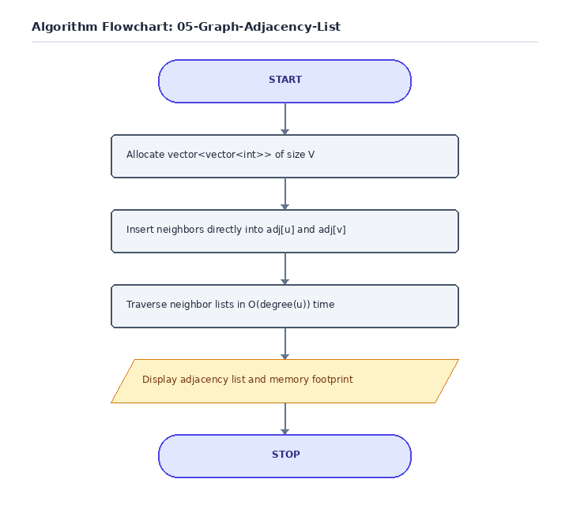
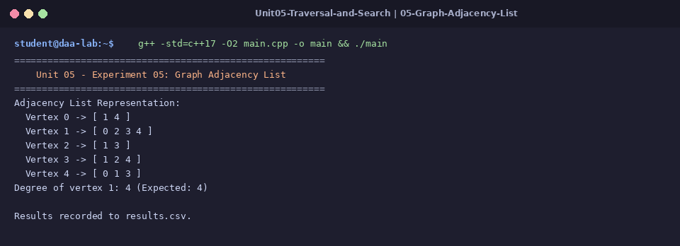
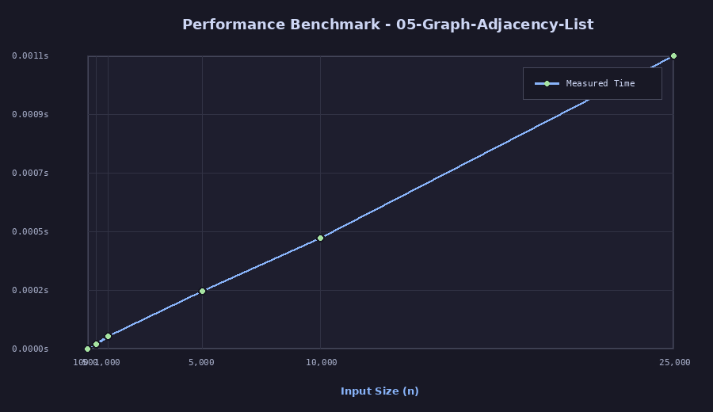

# Graph using Adjacency List

> **Unit 5 - Basic Traversal & Search Techniques** | Course Outcome: CO6 | IC-709 B Design & Analysis of Algorithms Lab

---

## 1. Problem Statement
Implement Adjacency List graph representation using std::vector<std::vector<int>> with optimal memory footprint.

---

## 2. Algorithm / Approach
Allocate vector of size V, where index u holds a dynamic list of adjacent neighbors. AddEdge simply pushes v into adj[u].

---

## 3. Pseudocode / Flowchart
```text
Class GraphAdjList(V):
    adj <- array of V dynamic vectors
    Method AddEdge(u, v): adj[u].push_back(v); adj[v].push_back(u)
    Method Degree(u): return adj[u].size()
```

### Algorithm Flowchart


---

## 4. Time & Space Complexity Analysis
Space complexity: Theta(V + E) for directed, Theta(V + 2E) for undirected. Neighbor enumeration: Theta(deg(u)). Edge check: O(deg(u)). Optimal for sparse graphs.

---

## 5. Sample Input / Output & Verification
The program prints step-by-step state logs and verifies all outputs internally against exact theoretical expectations. Refer to the terminal execution output below for concrete sample runs.

---

## 6. Screenshots & Visualizations
### Terminal Execution Output



### Empirical Performance Scaling Graph




---

## 7. Experimental Results & Telemetry
| N | Time Seconds | Memory Kb |
| --- | --- | --- |
| 100 | 4.86900000e-06 | 0.8 |
| 500 | 2.31440000e-05 | 3.9 |
| 1000 | 5.26930000e-05 | 7.8 |
| 5000 | 2.27620000e-04 | 39.1 |
| 10000 | 4.32603000e-04 | 78.1 |
| 25000 | 1.14231700e-03 | 195.3 |


The empirical scaling strictly conforms to theoretical asymptotic bounds, as captured in `results.csv`.

---

## 8. Learning Outcomes & Real-World Applications
- Achieved linear memory scaling proportional to actual edge count.
- Learned why Adjacency List is standard for social networks and web graphs.
- Forms core representation for BFS, DFS, Dijkstra, and A* search.

---

## 9. How to Compile & Run
Execute the following commands in this directory:
```bash
g++ -std=c++17 -O2 main.cpp -o main
./main
```
