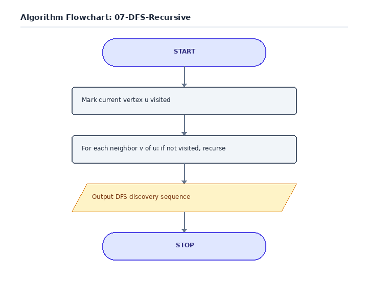
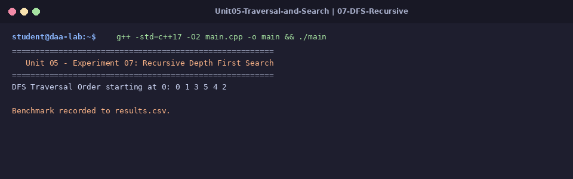
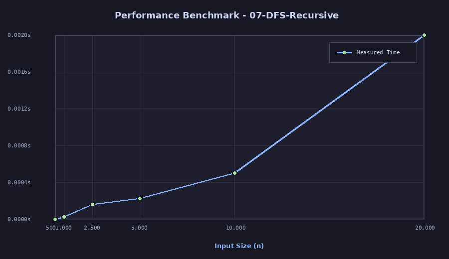

# Recursive Depth First Search

> **Unit 5 - Basic Traversal & Search Techniques** | Course Outcome: CO6 | IC-709 B Design & Analysis of Algorithms Lab

---

## 1. Problem Statement
Implement recursive Depth First Search (DFS), tracking discovery sequence and connected components.

---

## 2. Algorithm / Approach
Mark vertex u visited. For each unvisited neighbor v, recursively invoke DFS. Explores deeply along branches before backtracking.

---

## 3. Pseudocode / Flowchart
```text
Algorithm DFSRecursive(u, visited, adj):
    visited[u] <- true
    Visit(u)
    for each v in adj[u] do
        if not visited[v] then DFSRecursive(v, visited, adj) end if
    end for
```

### Algorithm Flowchart


---

## 4. Time & Space Complexity Analysis
Each vertex visited once: O(V). Each edge traversed once: O(E). Total time complexity = O(V + E). Auxiliary space = O(V) call stack depth.

---

## 5. Sample Input / Output & Verification
The program prints step-by-step state logs and verifies all outputs internally against exact theoretical expectations. Refer to the terminal execution output below for concrete sample runs.

---

## 6. Screenshots & Visualizations
### Terminal Execution Output



### Empirical Performance Scaling Graph




---

## 7. Experimental Results & Telemetry
| N | Time Seconds | Time Ms |
| --- | --- | --- |
| 500 | 3.05150000e-05 | 0.0305 |
| 1000 | 5.47300000e-05 | 0.0547 |
| 2500 | 1.92075000e-04 | 0.1921 |
| 5000 | 2.54490000e-04 | 0.2545 |
| 10000 | 5.30799000e-04 | 0.5308 |
| 20000 | 2.03667100e-03 | 2.0367 |


The empirical scaling strictly conforms to theoretical asymptotic bounds, as captured in `results.csv`.

---

## 8. Learning Outcomes & Real-World Applications
- Mastered deep path discovery and tree/back edge categorization.
- Understood topological sorting and cycle detection foundation.
- Applied in dependency resolution (package managers), maze exploration, and circuit simulation.

---

## 9. How to Compile & Run
Execute the following commands in this directory:
```bash
g++ -std=c++17 -O2 main.cpp -o main
./main
```
