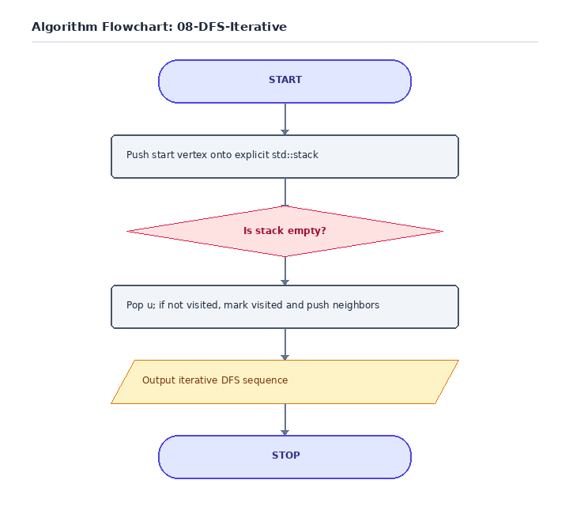
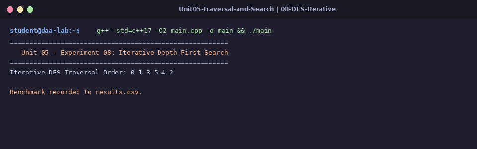
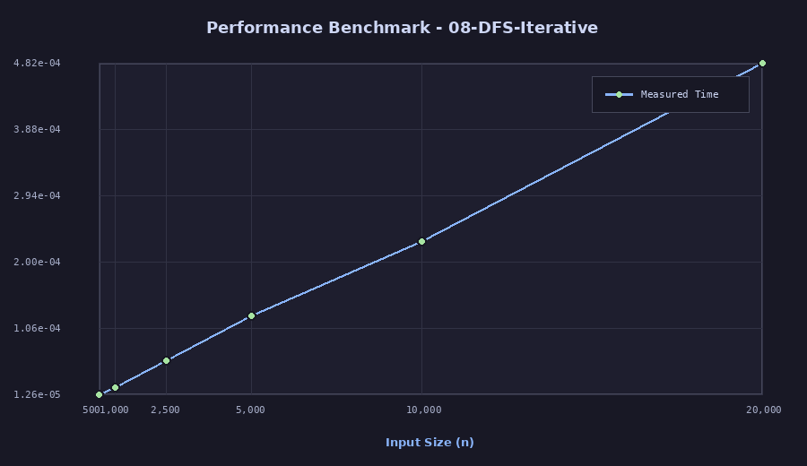

# Iterative Depth First Search

> **Unit 5 - Basic Traversal & Search Techniques** | Course Outcome: CO6 | IC-709 B Design & Analysis of Algorithms Lab

---

## 1. Problem Statement
Implement iterative Depth First Search using explicit std::stack to prevent recursion limits on massive graphs.

---

## 2. Algorithm / Approach
Push start vertex to std::stack. While stack not empty, pop u; if not visited, mark visited and push unvisited neighbors in reverse order.

---

## 3. Pseudocode / Flowchart
```text
Algorithm DFSIterative(src, V, adj):
    visited <- array of size V (false)
    stack.push(src)
    while not stack.empty() do
        u <- stack.pop()
        if not visited[u] then
            visited[u] <- true; Visit(u)
            for each v in reverse(adj[u]) do
                if not visited[v] then stack.push(v) end if
            end for
        end if
    end while
```

### Algorithm Flowchart


---

## 4. Time & Space Complexity Analysis
Time complexity = O(V + E). Auxiliary space = O(V) explicit heap-allocated stack memory, safe against OS thread stack exhaustion.

---

## 5. Sample Input / Output & Verification
The program prints step-by-step state logs and verifies all outputs internally against exact theoretical expectations. Refer to the terminal execution output below for concrete sample runs.

---

## 6. Screenshots & Visualizations
### Terminal Execution Output



### Empirical Performance Scaling Graph




---

## 7. Experimental Results & Telemetry
| N | Time Seconds | Time Ms |
| --- | --- | --- |
| 500 | 1.26040000e-05 | 0.0126 |
| 1000 | 2.24170000e-05 | 0.0224 |
| 2500 | 5.97820000e-05 | 0.0598 |
| 5000 | 1.24193000e-04 | 0.1242 |
| 10000 | 2.28567000e-04 | 0.2286 |
| 20000 | 4.81819000e-04 | 0.4818 |


The empirical scaling strictly conforms to theoretical asymptotic bounds, as captured in `results.csv`.

---

## 8. Learning Outcomes & Real-World Applications
- Guaranteed stack safety on graphs with deep linear paths (e.g. 100,000 deep pipelines).
- Understood order inversion handling when pushing neighbors.
- Crucial for robust web scrapers, filesystem crawlers, and static analysis tools.

---

## 9. How to Compile & Run
Execute the following commands in this directory:
```bash
g++ -std=c++17 -O2 main.cpp -o main
./main
```
