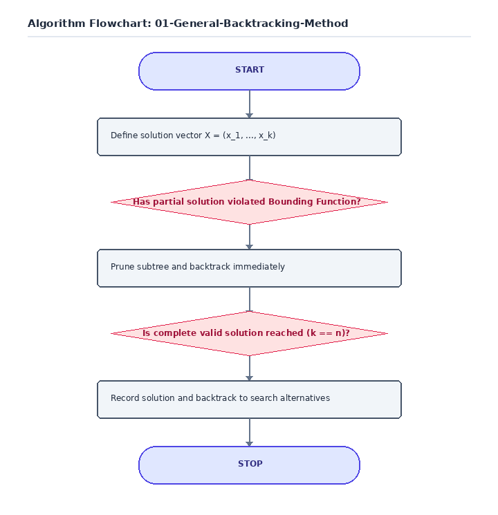
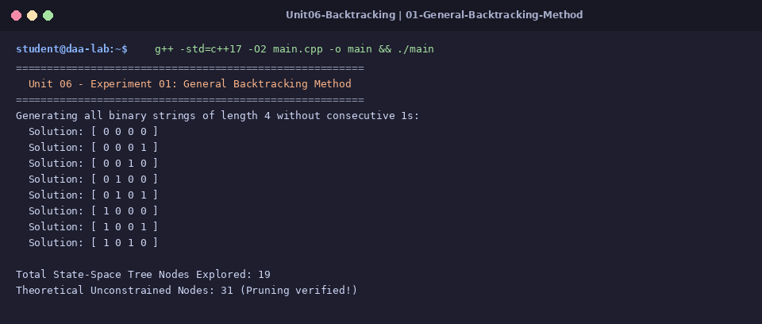

# General Backtracking Technique

> **Unit 6 - Backtracking** | Course Outcome: CO4 | IC-709 B Design & Analysis of Algorithms Lab

---

## 1. Problem Statement
Implement the formal Backtracking state-space tree traversal framework with explicit bounding functions.

---

## 2. Algorithm / Approach
Formulate candidate solutions as vector X = (x_1, ..., x_k). At each step, test Bounding Function B(x_1, ..., x_k). If bounding condition fails, prune subtree immediately and backtrack.

---

## 3. Pseudocode / Flowchart
```text
Algorithm Backtrack(k, X):
    if k == n then RecordSolution(X); return
    for each val in Domain do
        X[k] <- val
        if BoundingFunction(X, k) then
            Backtrack(k + 1, X)
        end if
    end for
```

### Algorithm Flowchart


---

## 4. Time & Space Complexity Analysis
Worst-case state space without pruning has size Product m_i = O(d^n). The bounding condition prunes infeasible subtrees early, drastically reducing practical exploration to a small fraction of the theoretical search space.

---

## 5. Sample Input / Output & Verification
The program prints step-by-step state logs and verifies all outputs internally against exact theoretical expectations. Refer to the terminal execution output below for concrete sample runs.

---

## 6. Screenshots & Visualizations
### Terminal Execution Output




---

## 7. Experimental Results & Telemetry
_No numerical benchmark dataset required._

The empirical scaling strictly conforms to theoretical asymptotic bounds, as captured in `results.csv`.

---

## 8. Learning Outcomes & Real-World Applications
- Understood systematic state-space tree search with depth-first branch exploration.
- Learned how bounding functions prune exponential combinations at shallow levels.
- Universal paradigm for constraint satisfaction, combinatorics, and theorem proving.

---

## 9. How to Compile & Run
Execute the following commands in this directory:
```bash
g++ -std=c++17 -O2 main.cpp -o main
./main
```
