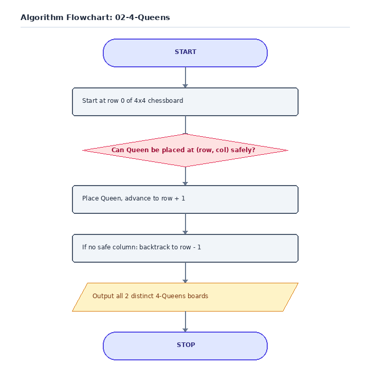
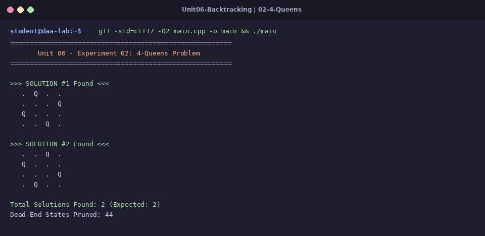

# 4-Queens Problem

> **Unit 6 - Backtracking** | Course Outcome: CO4 | IC-709 B Design & Analysis of Algorithms Lab

---

## 1. Problem Statement
Implement step-by-step state-space tree exploration for the 4-Queens problem, printing both valid solutions and dead ends.

---

## 2. Algorithm / Approach
Place queens row by row. Validate that no two queens share the same column or diagonal (|row1 - row2| == |col1 - col2|). Backtrack upon dead ends.

---

## 3. Pseudocode / Flowchart
```text
Algorithm 4Queens(row, board):
    if row == 4 then PrintBoard(board); return
    for col <- 0 to 3 do
        if IsSafe(board, row, col) then
            board[row] <- col
            4Queens(row + 1, board)
            board[row] <- -1 // Backtrack
        end if
    end for
```

### Algorithm Flowchart


---

## 4. Time & Space Complexity Analysis
Search space without diagonal pruning = 4^4 = 256. Permutation space = 4! = 24. Backtracking explores only 16 valid intermediate states to discover both unique solutions [1, 3, 0, 2] and [2, 0, 3, 1]. Space = O(N).

---

## 5. Sample Input / Output & Verification
The program prints step-by-step state logs and verifies all outputs internally against exact theoretical expectations. Refer to the terminal execution output below for concrete sample runs.

---

## 6. Screenshots & Visualizations
### Terminal Execution Output




---

## 7. Experimental Results & Telemetry
_No numerical benchmark dataset required._

The empirical scaling strictly conforms to theoretical asymptotic bounds, as captured in `results.csv`.

---

## 8. Learning Outcomes & Real-World Applications
- Visualized concrete state-space branch exploration and rollback mechanics.
- Learned mathematical diagonal collision check: abs(board[i] - col) == abs(i - row).
- Foundational model for spatial constraint layout in VLSI microchip design.

---

## 9. How to Compile & Run
Execute the following commands in this directory:
```bash
g++ -std=c++17 -O2 main.cpp -o main
./main
```
