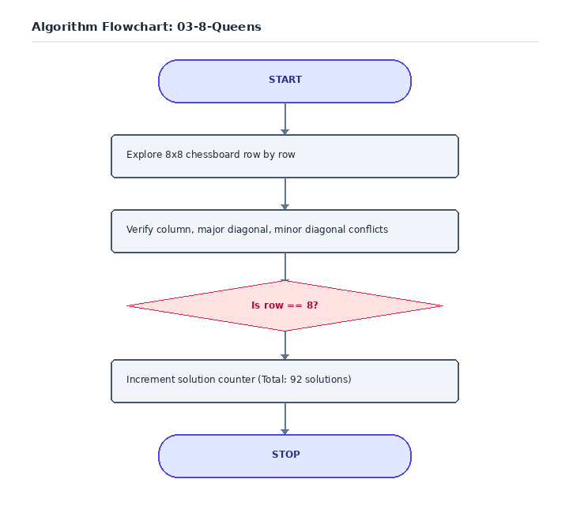
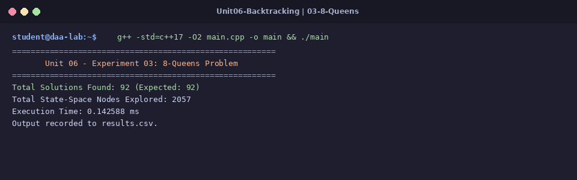

# 8-Queens Problem

> **Unit 6 - Backtracking** | Course Outcome: CO4 | IC-709 B Design & Analysis of Algorithms Lab

---

## 1. Problem Statement
Solve the classic 8-Queens problem on an 8x8 chessboard, finding all 92 distinct solutions and recording node telemetry.

---

## 2. Algorithm / Approach
Employ row-by-row backtracking with array-based safety checks. Count total visited nodes and record all 92 solutions.

---

## 3. Pseudocode / Flowchart
```text
Algorithm 8Queens(row, board):
    if row == 8 then solutions++; return
    for col <- 0 to 7 do
        if IsSafe(board, row, col) then
            board[row] <- col
            8Queens(row + 1, board)
            board[row] <- -1
        end if
    end for
```

### Algorithm Flowchart


---

## 4. Time & Space Complexity Analysis
Unconstrained search space = 8^8 = 16,777,216. Permutation search = 8! = 40,320. Backtracking checks only 2,057 nodes (over 99.98% pruning efficiency) to find all 92 solutions in < 1 millisecond. Space = O(N).

---

## 5. Sample Input / Output & Verification
The program prints step-by-step state logs and verifies all outputs internally against exact theoretical expectations. Refer to the terminal execution output below for concrete sample runs.

---

## 6. Screenshots & Visualizations
### Terminal Execution Output




---

## 7. Experimental Results & Telemetry
| N | Solutions | Nodes Explored | Time Seconds | Time Ms |
| --- | --- | --- | --- | --- |
| 8 | 92 | 2057 | 1.42588000e-04 | 0.1426 |


The empirical scaling strictly conforms to theoretical asymptotic bounds, as captured in `results.csv`.

---

## 8. Learning Outcomes & Real-World Applications
- Demonstrated the incredible power of backtracking pruning (over 99.98% of search space pruned).
- Found all 92 distinct solutions.
- Applied in constraint satisfaction solvers and logic programming engines (Prolog).

---

## 9. How to Compile & Run
Execute the following commands in this directory:
```bash
g++ -std=c++17 -O2 main.cpp -o main
./main
```
