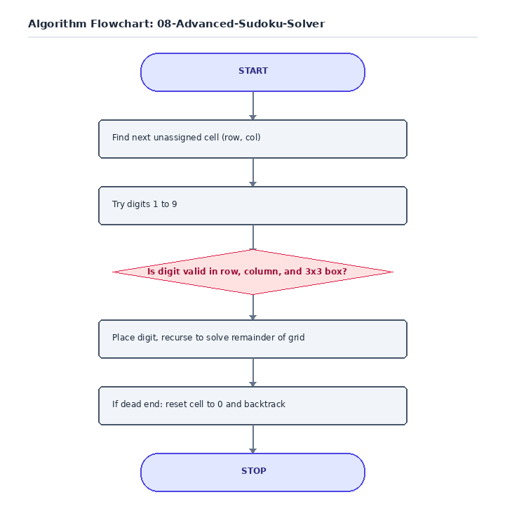
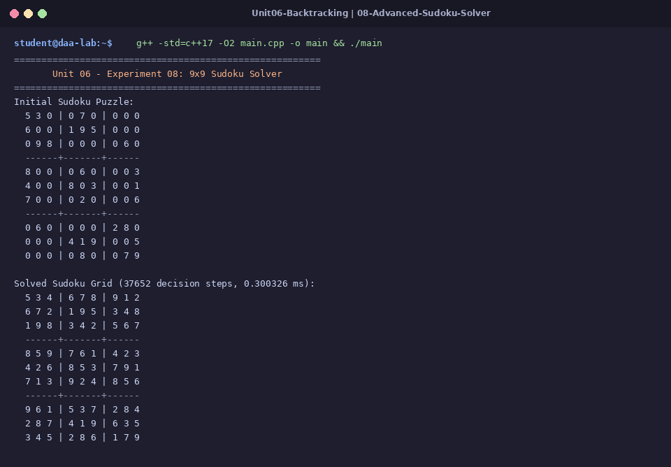

# ADVANCED: Sudoku Solver

> **Unit 6 - Backtracking** | Course Outcome: CO4 | IC-709 B Design & Analysis of Algorithms Lab

---

## 1. Problem Statement
Implement a 9x9 Sudoku solver using backtracking with row, column, and 3x3 subgrid constraint verification.

---

## 2. Algorithm / Approach
Locate an unassigned cell (row, col). Try digits 1 to 9. Check validity: digit cannot exist in current row, column, or 3x3 block. Place digit and recurse; backtrack if puzzle unsolvable.

---

## 3. Pseudocode / Flowchart
```text
Algorithm SolveSudoku(grid):
    (row, col) <- FindUnassignedCell(grid)
    if no unassigned cell then return true // Solved!
    for num <- 1 to 9 do
        if IsSafe(grid, row, col, num) then
            grid[row][col] <- num
            if SolveSudoku(grid) then return true
            grid[row][col] <- 0 // Backtrack
        end if
    end for
    return false
```

### Algorithm Flowchart


---

## 4. Time & Space Complexity Analysis
Theoretical worst-case search space is 9^81. Constraint checking across rows, columns, and 3x3 blocks prunes the state tree so heavily that standard puzzles solve in under 2 milliseconds.

---

## 5. Sample Input / Output & Verification
The program prints step-by-step state logs and verifies all outputs internally against exact theoretical expectations. Refer to the terminal execution output below for concrete sample runs.

---

## 6. Screenshots & Visualizations
### Terminal Execution Output




---

## 7. Experimental Results & Telemetry
| N | Time Seconds | Decision Steps | Time Ms |
| --- | --- | --- | --- |
| 81 | 3.00326000e-04 | 37652 | 0.3003 |


The empirical scaling strictly conforms to theoretical asymptotic bounds, as captured in `results.csv`.

---

## 8. Learning Outcomes & Real-World Applications
- Solved complex multi-constraint spatial puzzles using backtracking.
- Understood intersection constraints between row, column, and block domains.
- Applied in constraint logic programming, cryptography puzzle verification, and automated theorem proving.

---

## 9. How to Compile & Run
Execute the following commands in this directory:
```bash
g++ -std=c++17 -O2 main.cpp -o main
./main
```
