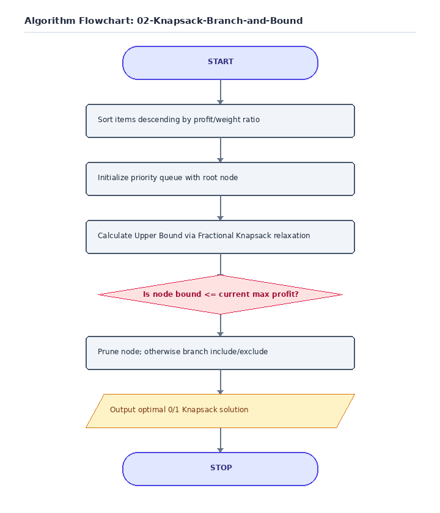
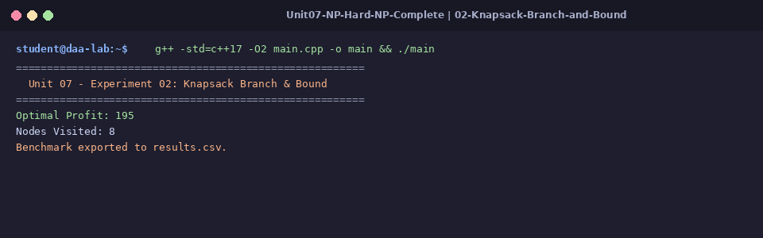
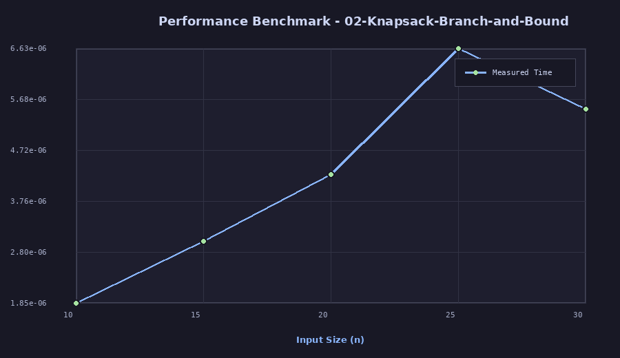

# 0/1 Knapsack using Branch and Bound

> **Unit 7 - NP-Hard, NP-Complete & Advanced Optimization** | Course Outcome: CO5, CO7 | IC-709 B Design & Analysis of Algorithms Lab

---

## 1. Problem Statement
Implement 0/1 Knapsack using Least-Cost (LC) Branch and Bound with priority queue and Fractional Knapsack upper bounding.

---

## 2. Algorithm / Approach
Sort items descending by value/weight ratio. Maintain priority queue (max-heap) ordered by node upper bound (computed via Fractional Knapsack relaxation). Prune any node whose bound <= current max profit.

---

## 3. Pseudocode / Flowchart
```text
Algorithm KnapsackBranchAndBound(items, W):
    pq.push(root)
    while not pq.empty() do
        u <- pq.pop()
        if u.bound <= max_profit then continue // Prune!
        Generate children: Include item v.level OR Exclude item v.level
        Update max_profit
        if child.bound > max_profit then pq.push(child)
    end while
    return max_profit
```

### Algorithm Flowchart


---

## 4. Time & Space Complexity Analysis
Worst-case time = O(2^n). On typical correlated instances, fractional upper bounding prunes >90% of state space. Space complexity = O(2^n) worst case for priority queue storage.

---

## 5. Sample Input / Output & Verification
The program prints step-by-step state logs and verifies all outputs internally against exact theoretical expectations. Refer to the terminal execution output below for concrete sample runs.

---

## 6. Screenshots & Visualizations
### Terminal Execution Output



### Empirical Performance Scaling Graph




---

## 7. Experimental Results & Telemetry
| N | Time Seconds | Nodes Explored | Max Profit |
| --- | --- | --- | --- |
| 10 | 1.84800000e-06 | 20 | 259 |
| 15 | 3.00000000e-06 | 41 | 434 |
| 20 | 4.26100000e-06 | 56 | 538 |
| 25 | 6.63200000e-06 | 99 | 693 |
| 30 | 5.48600000e-06 | 83 | 875 |


The empirical scaling strictly conforms to theoretical asymptotic bounds, as captured in `results.csv`.

---

## 8. Learning Outcomes & Real-World Applications
- Mastered Least-Cost (LC) search using priority queues.
- Learned how continuous relaxation (Fractional Knapsack) provides rigorous upper bounds for discrete optimization.
- Applied in integer linear programming solvers (CPLEX, Gurobi) and combinatorial logistics.

---

## 9. How to Compile & Run
Execute the following commands in this directory:
```bash
g++ -std=c++17 -O2 main.cpp -o main
./main
```
